<p align="center"></p>

# HyperStack

**One workspace for everyone who ships software.**

<p align="center">
  <a href="https://github.com/mzaki-raup/hyper-stack/releases"></a>
  <a href="https://github.com/mzaki-raup/hyper-stack/releases/latest"></a>
  <a href="LICENSE"></a>
  <a href="https://github.com/mzaki-raup/hyper-stack/actions/workflows/ci.yml"></a>
  <a href="https://github.com/mzaki-raup/hyper-stack/stargazers"></a>
</p>

<p align="center"></p>

HyperStack is a desktop application for full-stack developers, DevOps engineers,
database administrators, testers and integration engineers. It brings the tools
those people switch between all day — code editor, SQL database client, NoSQL
document-store client, Redis cache viewer, API client, SSH/SFTP, S3 browser,
Git, terminal, log tail viewer and a drawer of developer utilities — into a
single window organised as a **multi-row, multi-tab workspace**, where every tool
shares the same connection profiles, environments, secrets store, command palette
and theme.

> **Status:** Phase 0 (foundation), M1 and M2 implemented, M3 under way and
> the first parts of M4 and M5 landed (2026-10-15): the workspace shell with
> workspaces as projects (create with a logo, clone, rename, switch, delete),
> a pinned **Home** dashboard and a pinned Settings tab in every workspace,
> portable data folder, vault, environments, theme modes (System / Dark /
> Light with a scheme for each), accessibility (Read Aloud), settings
> import/export, a terminal with scrollback search and Ctrl+click links, a
> code editor holding several projects (each with its own row of file tabs,
> the file's full path under them, Run with F5, Git status, diffs and
> history) and Markdown preview with native Mermaid diagrams, an SSH + SFTP
> tool with a synced dual pane, port forwarding and a file pane that copies
> files and folders to and from the system clipboard, an S3 browser for AWS
> and S3-compatible stores, a SQL client for PostgreSQL, MySQL/MariaDB and
> SQLite with a cell viewer that previews pictures and documents, a **Redis**
> key browser with type-aware viewers, a console and guards, a **NoSQL**
> client for MongoDB and CouchDB, an **API
> client** with collections, JavaScript scripts (`pm` API) and Postman
> import/export, **Devtools** (Base64, URL encoding, hashes, JWT, Firebase
> tokens, Jasypt, PKI messages; one tab per utility, inputs persisted, secrets
> saved to the environment vault and used as `{{variables}}`), a **Graphics** tool (convert, resize, extend,
> adjust, icons), an embedded **Browser** (WebView2, ad and script> blocking, forced dark, inspect, print), **Snip** and **Print…** for every
> tab, an optional AI assistant in the editor (Anthropic, Gemini, Azure
> OpenAI, AWS Bedrock, 1min.AI, LM Studio, Ollama or any OpenAI-compatible
> service; pictures from 1min.AI or a self-hosted AUTOMATIC1111, ComfyUI,
> SwarmUI, InvokeAI or Fooocus server) and a review-only assistant in
> Terminal, SSH, SQL, Redis, NoSQL, S3, API client and Graphics whose code blocks can be
> inserted but never run, and the in-app updater with signed releases.
> Since then: the **Logs** activity (2026-10-22: local, SSH, command and
> pasted sources, parsers for plain/JSON/logfmt/syslog/Nginx/PostgreSQL
> and JVM thread dumps, filters, find, bookmarks), the **Containers**
> activity (2026-10-24: Docker, Podman, Kubernetes and Windows
> containers; images, Compose, pod logs into Logs, a shell in a pod),
> a **dashboard home tab** for every activity (2026-10-27: summaries,
> Start Here, the saved things, what is open), **global variables** and
> collection variables compared and synced across workspaces
> (2026-10-29), Scratchpad notes that resolve `{{variables}}` and open
> their links in the Browser, and the **Git activity** (2026-10-29/30,
> v0.98 to v0.103): saved repositories, a SourceTree-style work pane
> with History graph, blame and a conflict editor, every branch / merge /
> rebase / stash / tag / Git Flow verb, hosts (Fetch Project, Clone and
> Save, tokens in the vault) and an AI Assistant. The remaining
> milestones are in [docs/07-roadmap.md](docs/07-roadmap.md). Sibling project:
> `../eden-explorer` (Rust + egui file manager) serves as a **reference
> only**: HyperStack studies how it solved the multi-row tab strip,
> terminal, SSH/SFTP, S3 and Git status, then writes its own
> implementation. No code is copied or shared.

The Graphics activity is being expanded (owner's request, 2026-10-19) into four
tools — Image, Icon, Diagram Editor and Diagram Generator — in two releases.
The first Release 1 phase landed on 2026-10-19: the activity sidebar, the
dashboard with Recent and screenshots, the separate Image and Icon tabs, and
Convert to Icon. The flowchart/architecture editor and the prompt generator
follow in the same release, with an AI assistant in every tool. Release 2 adds
ERD and sequence diagrams plus Archify JSON and draw.io XML import. The
requirements and design are in [docs/tools/diagrams.md](docs/tools/diagrams.md);
the pinned Archify schema adaptation is recorded in
[THIRD_PARTY_NOTICES.md](THIRD_PARTY_NOTICES.md).

---

## Screenshots

Every feature built today, captured from a real `HyperStack` build on
Windows 11 (HyperStack Dark, activity rail labels on). See
[docs/screenshots/](docs/screenshots/README.md) for how they were made and
the fixtures behind them.

| Category | What the shots cover |
|---|---|
| [Shell and workspaces](#shell-and-workspaces) | Home, launcher, palette, tabs, dock, workspaces, environments |
| [Vault and connections](#vault-and-connections) | First-run vault, unlock, profiles and secrets |
| [Editor](#editor) | Projects, files, Markdown and Mermaid, LSP, debugger, AI assistant |
| [Git](#git) | Git in the editor, and the **Git activity**: dashboard, File Status, History graph, blame, conflicts, Git Flow, hosts, assistant |
| [Terminal](#terminal) | Shells, search, links |
| [SSH and SFTP](#ssh-and-sftp) | Host keys, dual pane, tunnels kept per host, broadcast input, server monitor, remote editing |
| [S3](#s3-and-s3-compatible-storage) | Buckets, profiles, object details with tags and versions, folder sync, presigned URLs, guards; **WebDAV** and **Nexus** too |
| [SQL databases](#sql-databases-postgresql-mysql--mariadb-sqlite) | Browser, completion, results, transactions, guards |
| [Redis](#redis) | Key tree, type viewers, console, Info dashboard, Slowlog / clients / big keys / bulk ops, Pub/Sub, Streams; **Valkey** too |
| [NoSQL](#nosql-mongodb-and-couchdb) | Containers, find, aggregate, indexes, documents; **Qdrant** too |
| [Logs](#logs) | Local, SSH, command, journald, Windows Event Log and pasted sources; merge, statistics, alerts; parsers, filters, find, bookmarks |
| [Queue](#queue) | RabbitMQ, Kafka, Redis Streams, NATS and MQTT: destinations with depth, peek without consuming, publish, consumer lag, guarded purge |
| [Automation](#automation) | Jenkins, TeamCity, GitHub Actions, GitLab CI, Forgejo Actions and AWX: jobs and runs, run with parameters, follow the log, guarded cancel |
| [API client](#api-client) | Requests, scripts, assistant |
| [Devtools](#devtools) | JWT, hashes, Jasypt, PKI, regex, diff, Base64, URL, YAML, generators, cron, units, network checks, listening ports, snippets, .env editor; the utility toolbar row |
| [Graphics](#graphics) | Activity dashboard, image and icon tabs, operations, crop |
| [Scratchpad and assistant](#scratchpad-and-assistant) | Notes, pinning, dictation |
| [Browser](#browser) | WebView2 pages, favourites, passwords |
| [Settings](#settings) | Every page, including Git and the Collection / Global Variables cards |

### Shell and workspaces

| | |
|---|---|
|  |  |
| **Home** — the pinned first tab of every workspace: a toolbar of activity icons across the top, Get Started cards, the workspace switcher and the What do you want to do? tool grid; recent and pinned items live in the sidebar | **Launcher** (Ctrl+T) — tools by category plus pinned connections, filtered as you type |
|  |  |
| **Command palette** (Ctrl+Shift+P) — every action, fuzzy-matched, with its shortcut | **Multi-row tab strip** — tabs wrap onto more rows instead of scrolling |
|  |  |
| **Split panes** (Ctrl+\) — two Scratchpad notes side by side, each with source and preview | **Bottom dock** (Ctrl+J) — Output, Jobs and Problems |
|  |  |
| **Workspace switcher** in the title bar, with the selected workspace logo | **New workspace** — name, logo, and copy environments/connections from another |
|  |  |
| **Environment switcher** — colour-coded, protected ones marked | **Protected Production** — red banner and frame on every tab |

Every activity opens on a **permanent tab of its own** - named after the
activity, with its icon, and it cannot be closed, pinned or duplicated.
Since 2026-10-27 that tab is a **dashboard laid out the same way in every
activity** (Editor, Git, Terminal, SSH, Containers, Database, NoSQL,
Redis, S3, API client, Graphics, Devtools, Logs, Scratchpad): a header
band, equal-width summary boxes, **Start Here** buttons that open the
right Settings form with the kind already chosen, a grid of the saved
things (shells, hosts, databases, collections, repositories, notes…) and
**Open Here**, the activity's open tabs each carrying the last picture
taken of its pane. Opening a connection, a note or a shell always makes a
tab beside it. Pinning a tab puts it directly after the permanent one.

| | |
|---|---|
| 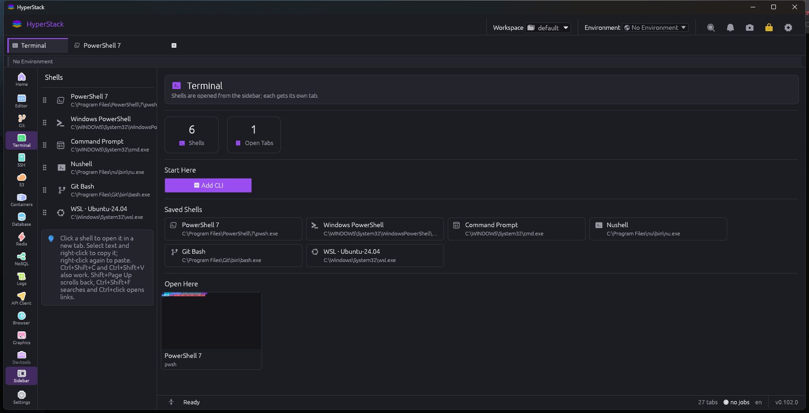 | 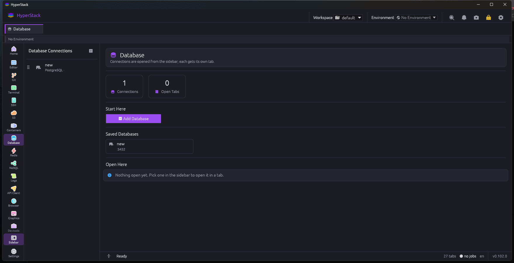 |
| **Terminal dashboard** - shells detected on the machine, Add CLI, Saved Shells, Open Here with a picture of the open session | **Database dashboard** - saved connections, Add Database, Open Here |

### Vault and connections

| | |
|---|---|
|  |  |
| **Create the vault** on first run (Argon2id + XChaCha20-Poly1305) | **Unlock** on start; the title-bar padlock locks it again |
|  |  |
| **Connection profile** (kind SSH) — host, user, start folder, auth | **Saved** — every tool sees the profile at once; typed secrets go to the vault and the profile keeps a `secret:` reference |

### Editor

| | |
|---|---|
|  |  |
| **Editor** — project tree with file icons, syntax highlighting, status bar (indent, encoding, EOL, language) | **Markdown preview** side by side (Ctrl+Shift+M) |
|  |  |
| **Find and replace** — case, whole word and regex, match count | **Mermaid flowcharts** drawn natively in the preview — subgraphs, shapes, wrapped wide ranks |
|  |  |
| **Projects as tabs** — each project root has one window tab; opening the same root again focuses it. Inside it, files are a second strip of tabs; both strips wrap onto more rows instead of hiding tabs. Files from outside the projects collect in an **Other Files** tab | **Model picker** — the models the provider lists (LM Studio: every downloaded model; 1min.AI: a built-in list), or type any other id |
|  |  |
| **Mermaid sequence diagrams** — participants, messages, notes, loop/alt blocks | **AI Assistant** (Ctrl+Shift+I) — chat about the file or the selection; Explain, Review, Improve, Add Comments; answers are review-only, with Insert for a code block and nothing run automatically |
|  |  |
| **Language server features** — completion as you type with documentation, hover, go to definition, references, rename and format through any installed LSP server (Settings → Editor → Language Servers shows which are found) | **Problems panel** (Ctrl+Shift+J) — diagnostics as underlines in the text, listed with file and line; the status bar counts errors and warnings |
|  |  |
| **Debugger** — breakpoints in the gutter (F9), the stopped line with an arrow, Continue/Step controls (F5, F10, F11), and the Variables tab of the debug panel; adapters (CodeLLDB, lldb-dap, debugpy, delve, netcoredbg) are installed by you, configurations come from `.hyperstack/debug.json`, `.vscode/launch.json` or are generated | **Call Stack** — frames of the paused thread; clicking one shows its variables and line |
|  | |
| **Cascade** — toggle it beside the scope to keep the assistant working on the updated file, one reviewable step at a time | **Terminal in the editor** (Ctrl+`) — a shell at the foot of the pane, started in the project's folder, several side by side; Run (F5) and Build go there, and a web app opens in the Browser at the address it prints |

### Git

| | |
|---|---|
|  |  |
| **Git in the editor** — the branch on the project, change letters and colours in the tree, change markers in the gutter as you type | **Source Control** (Ctrl+Shift+G) — staged, changed and untracked files; diffs inline or side by side; Up/Down steps through them |
|  | |
| **History** (Ctrl+Shift+H) — commits with branch and tag chips; each commit's message, files and diffs | **Commit, push, pull, stash, branches, tags** — stage and unstage from the list, discard with a question, commit (and push) with a Conventional Commit prefix, fetch/pull/push as jobs, stashes, branches, remotes and lightweight or annotated tags; a protected remote asks before a push and never gets a force |
|  |  |
| **Conflict editor** — an unmerged file opens block by block: Ours and Theirs under their marker labels, then Ours / Theirs / Both / a typed result per block; **Save and Mark Resolved** writes the file without markers and stages it | **Interactive Rebase** — commits oldest first with Pick / Squash / Fixup / Drop and move arrows; merge, rebase and cherry-pick offer Continue / Skip / Abort when Git pauses |
|  |  |
| **Tags** - lightweight or annotated, created from their own menu and pushed or deleted per tag | **Commit prefixes** - pick a Conventional Commit type; it is inserted once with its meaning, and Clear Prefix removes it |

**The Git activity** (2026-10-29/30, v0.98 to v0.103, spec
[docs/tools/git-activity.md](docs/tools/git-activity.md)) sits right after
Editor in the rail and manages repositories SourceTree-style, apart from
whatever the editor has open.

<p align="center">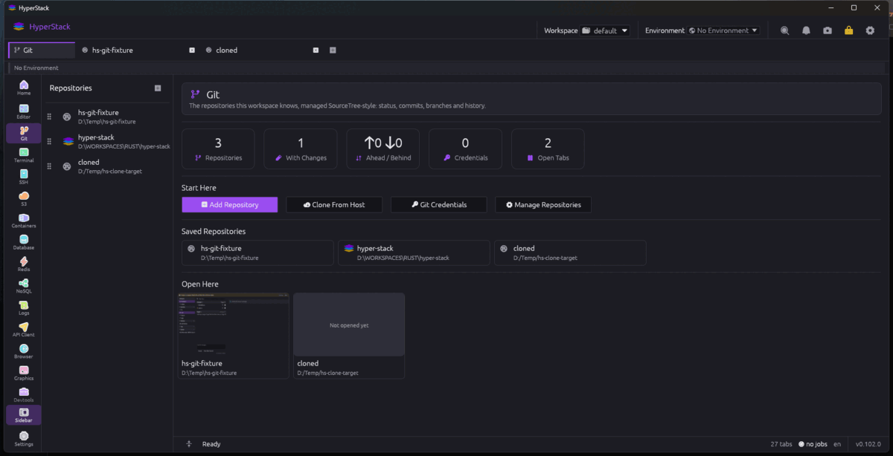</p>

| | |
|---|---|
|  | 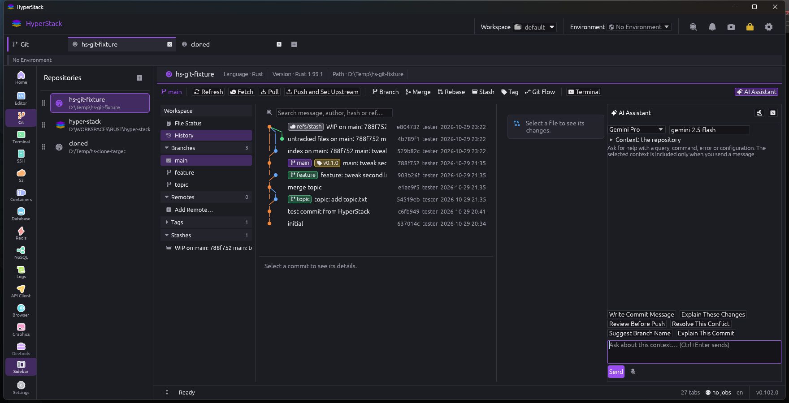 |
| **Dashboard** - Repositories, With Changes, Ahead / Behind, Credentials and Open Tabs; Start Here (Add Repository, Clone From Host, Git Credentials, Manage Repositories); Saved Repositories with their icons; Open Here | **Repository tab** - header band (icon, name, language, toolchain version, URL, path), the toolbar (branch, Refresh, Fetch, Pull, Push, Branch, Merge, Rebase, Stash, Tag, Git Flow, Terminal, AI Assistant), the tree (File Status / History, Branches with ahead/behind, Remotes, Tags, Stashes), unstaged and staged lists with Stage / Unstage / Discard, the diff with **Stage / Discard per hunk**, the commit box with Amend and Push After Commit - here under the bar a paused merge shows, with Continue and Abort |
| 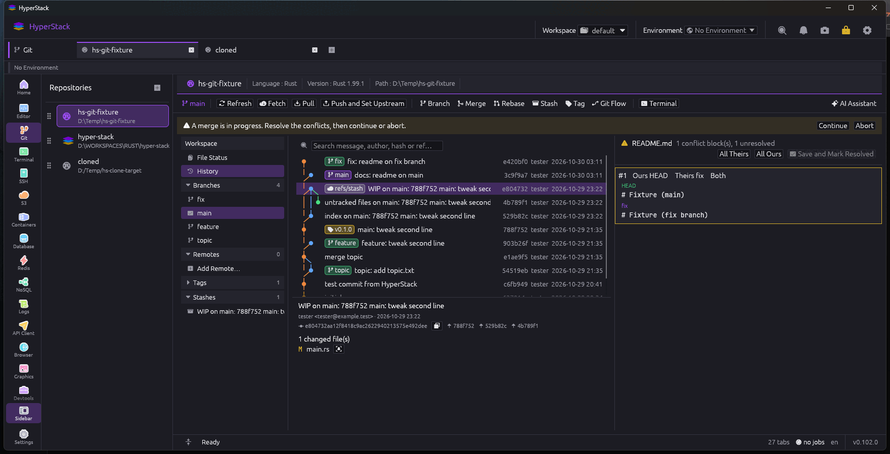 | 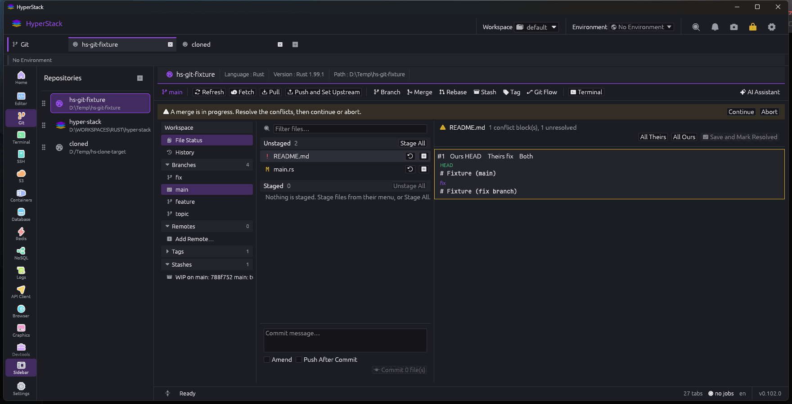 |
| **History** - the commit graph of every branch with lanes, branch / tag / stash chips, author and date, a search over message, author, hash and ref, Load More; the selected commit's message, hash, parents and changed files, each opening its diff or its blame | **Conflict editor** - an unmerged file block by block: Ours and Theirs under their labels, Ours / Theirs / Both per block, All Ours / All Theirs, and **Save and Mark Resolved**, which writes the file and stages it |
| 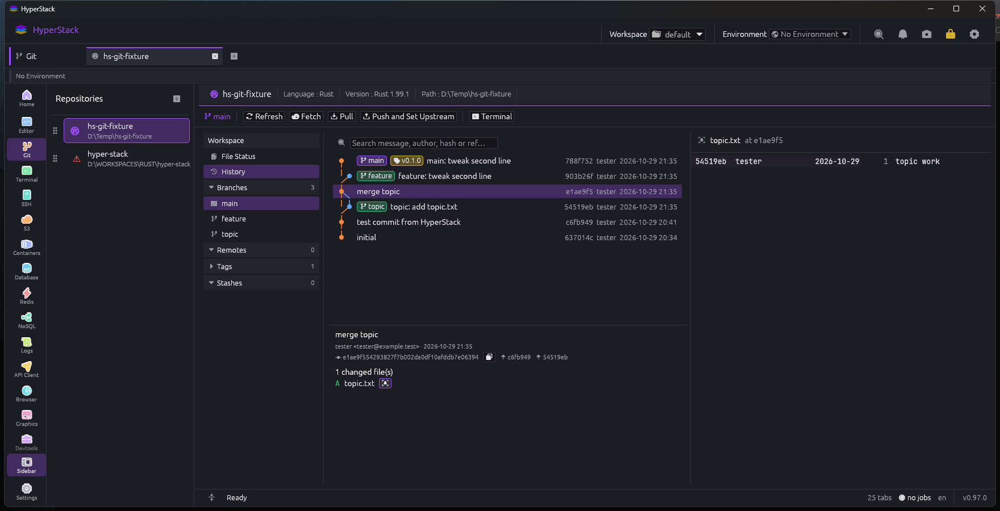 | 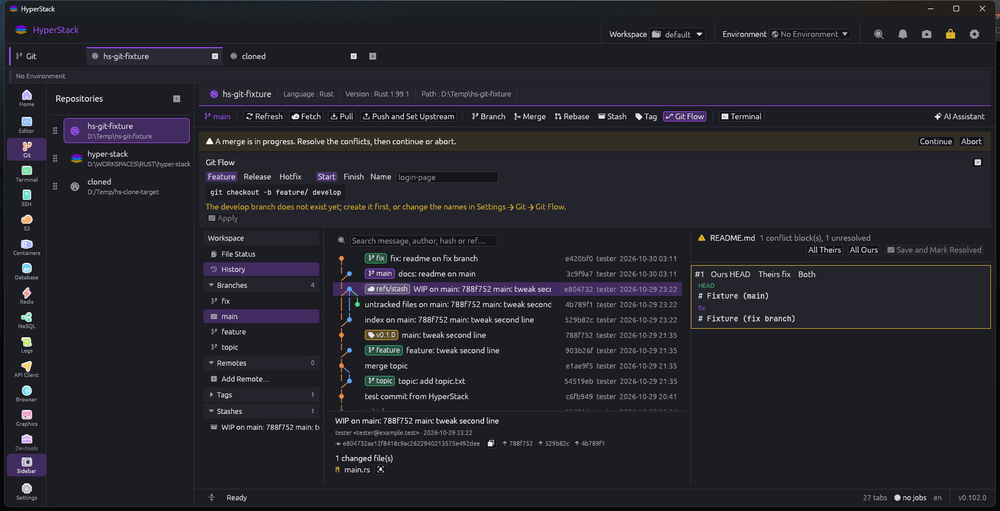 |
| **Blame** - every line with its commit, author and date in a gutter coloured by age; clicking a line finds its commit in History | **Git Flow** - Feature / Release / Hotfix, Start or Finish, built from plain git with the exact commands shown before Apply (a finish merges with `--no-ff`, tags production and merges back into develop); the names live in Settings → Git |
| 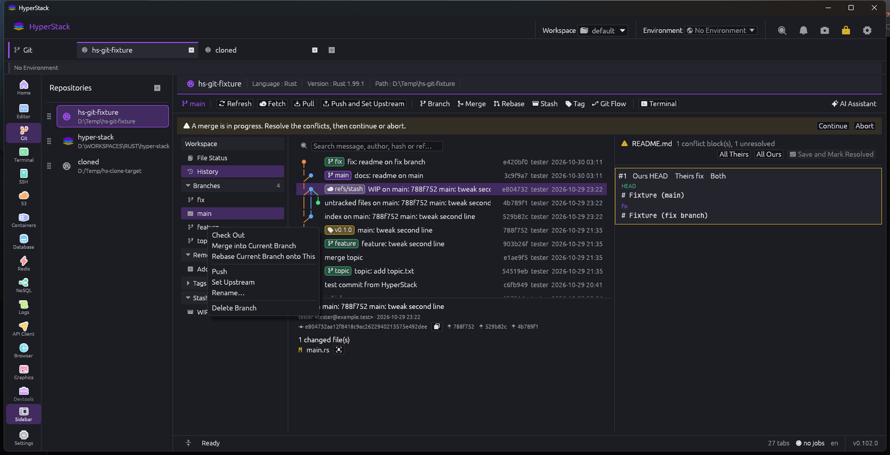 | 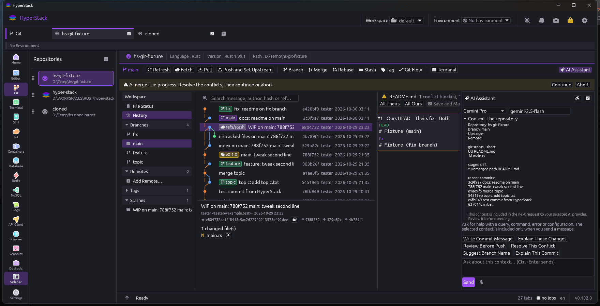 |
| **Right-click menus** - a branch: Check Out, Merge into Current, Rebase Current onto, Push, Set Upstream, Rename, Delete; a remote branch, a remote, a tag, a stash and a History row have theirs (cherry-pick, create branch here, tag here…); deletions and pushes onto a protected branch ask first | **AI Assistant** - the repository as context (branch, upstream, remote, status, a bounded staged diff, recent commits) and six prompt buttons; a `commit` block's Insert fills the commit box, a command block's Insert and Run runs it in a terminal opened in the repository root |
| 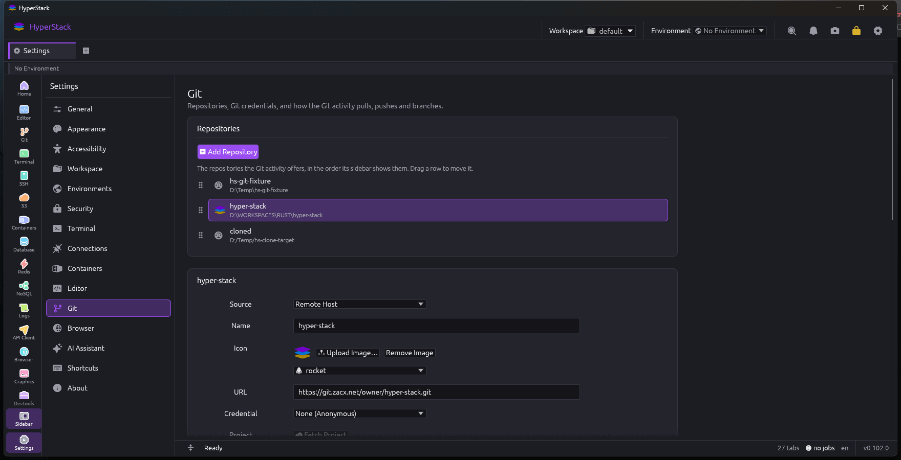 | 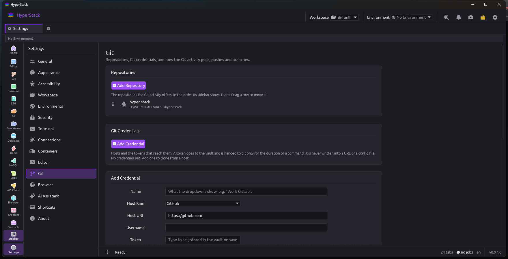 |
| **Settings → Git** - the repository list (drag to reorder) and a master/detail form: Local Folder, Localhost or Remote Host source, name, an **uploaded icon** or a glyph, URL, credential, **Fetch Project** (a fuzzy-searchable list of everything the token can see; the host's avatar becomes the icon), path and language; **Clone and Save** clones a folder that does not exist yet as a cancellable Job; Save stays disabled until the mandatory fields hold | **Git Credentials** - GitHub, GitLab, Forgejo, Gitea, Bitbucket, Azure DevOps or generic; host URL, username and a token that goes to the **vault** and reaches git for one command at a time through a helper file deleted afterwards; **Test** asks the host who the token belongs to. The General card below holds protected patterns, pull with rebase, sign-off, stash untracked, the default clone folder, the terminal profile and the Git Flow names |

Removing a repository from the list closes its tabs and **never touches
the folder**; every verb is also a palette command, and Up / Down walk
the lists.

### Terminal

| | |
|---|---|
|  |  |
| **Terminal** — shell profiles in the sidebar, colours, restart/clear, opened here from the editor with "Open Terminal Here" | **Search** (Ctrl+Shift+F) — plain or regex, match case, every hit highlighted, "n of m" |
|  |  |
| **Shell list** - PowerShell 7, Command Prompt, Nushell and Git Bash, ordered by preference | **Links** - hold Ctrl to underline a URL or `path:line:col`; Ctrl+click opens it in the browser or the editor |
|  | |
| **CLI tools** (Settings → Terminal) - a profile such as `cmd /k echo Hello from CLI`, `mysql`, `psql`, `claude` or `opencode` opens a terminal tab and types its command line once the shell is ready | |

### SSH and SFTP

| | |
|---|---|
|  |  |
| **Host key check** — new keys are shown by fingerprint before trusting | **Dual pane** — remote files (SFTP) on the left, the shell on the right |
|  |  |
| **Follow Shell Folder** — `cd` in the shell moves the file pane | **Edit remote files** — double-click downloads into the editor; saving uploads |
|  | 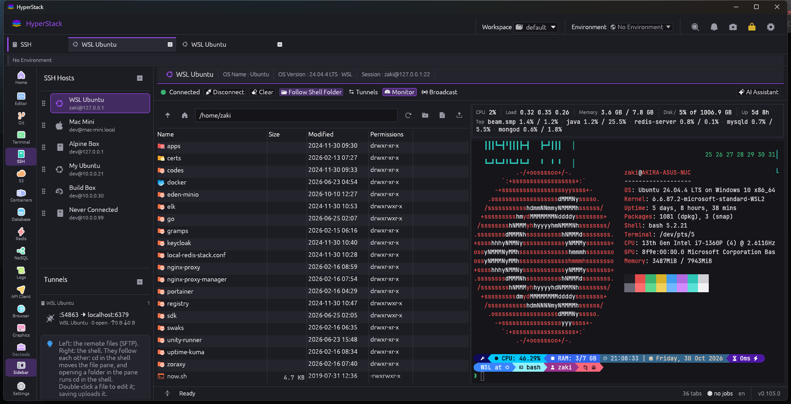 |
| **Tunnels** — local port forwards (`ssh -L`) with live traffic; New Tunnel form in the sidebar; a Tunnels pane above the shell with forwards **kept on the host** that start on connect | **Monitor and Broadcast** — CPU, load, memory, disk, uptime and top processes read every five seconds over the exec channel; Broadcast sends what is typed to every other open shell of the host |
| | |
| **Clipboard** — Copy puts a remote entry (a folder with everything in it) on the system clipboard; paste uploads what the clipboard holds (Windows) | |

### S3 and S3-compatible storage

| | |
|---|---|
|  |  |
| **Browser** — profiles in the sidebar; buckets and the open bucket's folders in the pane's left column, breadcrumb, size / modified / class / ETag, Load More | **Profile** — provider presets (AWS, MinIO, R2, B2, Spaces, Wasabi), keys stored in the vault |
| 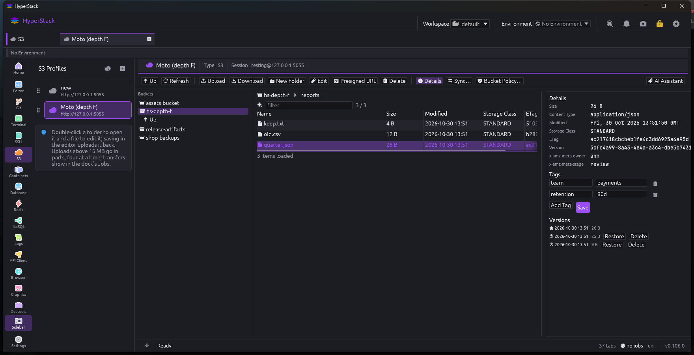 | 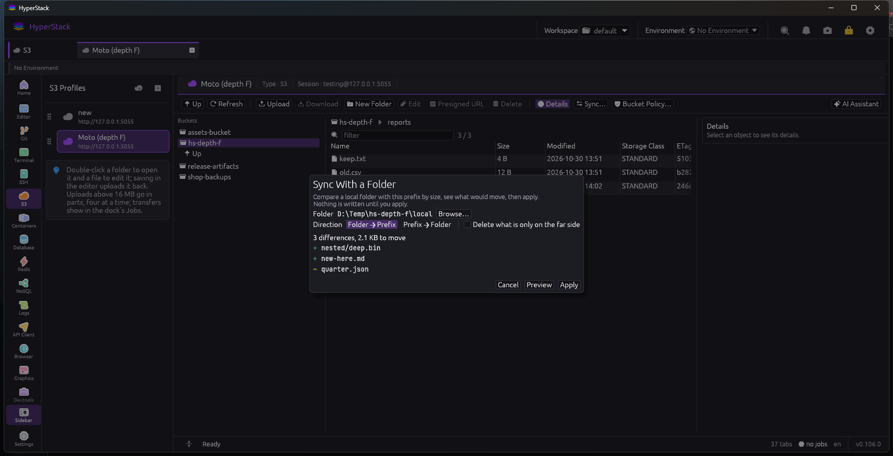 |
| **Details** - the selected object's metadata and `x-amz-meta-*` headers, its tags (editable) and, on a versioned bucket, every version with Restore and Delete | **Sync** - compare a local folder with the prefix by size either way, see what would move, then apply it as a Job; **Bucket Policy…** shows the policy and CORS rules read-only |
|  |  |
| **Import** profiles from `~/.aws/credentials` and `~/.aws/config` | **Presigned URLs** — GET or PUT, 15 minutes to 7 days |
|  |  |
| **Guarded delete** — prefixes and protected environments need the bucket name typed; shows versioning | **Edit objects** — double-click opens it in the editor; saving puts it back |

### SQL databases (PostgreSQL, MySQL / MariaDB, SQLite)

<p align="center"></p>

| | |
|---|---|
|  |  |
| **Schema browser** — schemas, tables, views and columns with types, indexes (functions and PK/FK/NOT NULL badges where the engine reports them); double-click a table for its rows | **Completion** from the schema cache — tables after FROM/JOIN, columns after an alias |
|  |  |
| **Result grid** — streamed rows, NULL shown as NULL, numbers right-aligned, sort, filter, Copy As, Export | **Scripts** — one result tab per statement; the failing one is selected and the server's error position underlined |
|  |  |
| **Protected environments** open read-only — writes are refused until **Allow Writes** | **Guards** — UPDATE/DELETE without WHERE, DROP, TRUNCATE ask first; on production the table name must be typed |
|  |  |
| **Transactions** — Auto-Commit or Manual Commit with Commit / Rollback and an open-transaction badge | **Cell viewer** — JSON pretty-printed, binary as a hex dump |
| 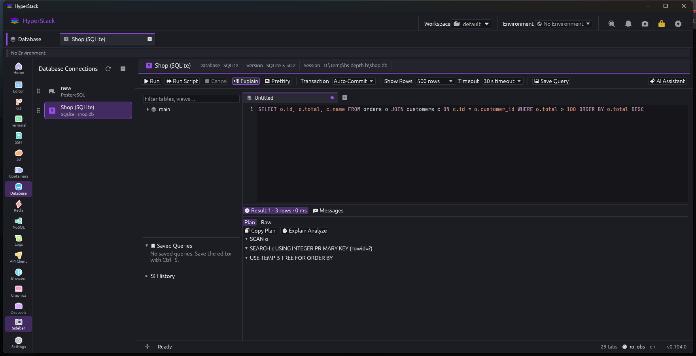 | 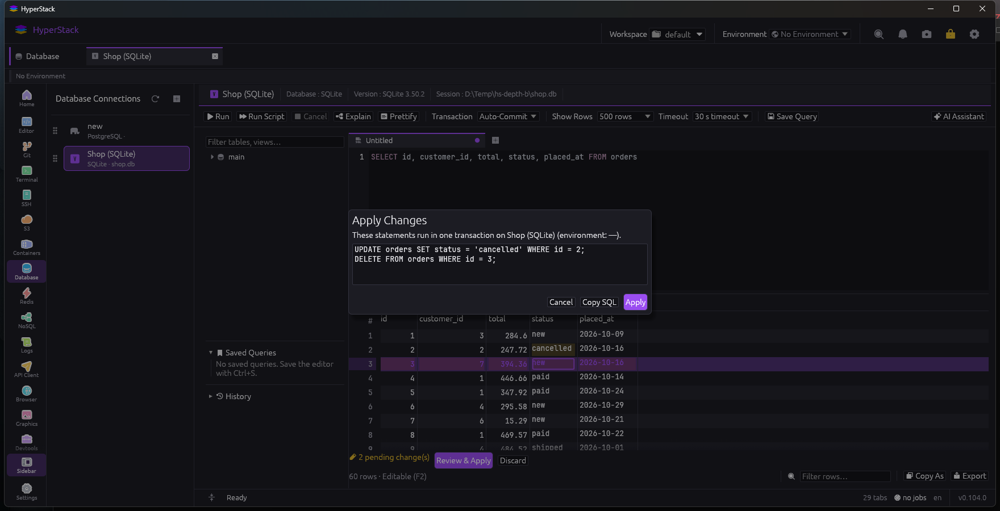 |
| **Explain** — the plan as a tree (JSON on PostgreSQL / MySQL, QUERY PLAN on SQLite) with cost, rows and times per node, the hottest nodes coloured, Explain Analyze for reads | **Inline editing** — a result from one keyed table edits in place (F2, Set NULL, Delete Row); Review & Apply shows the generated UPDATE / DELETE and runs them in one transaction through the guards |
| 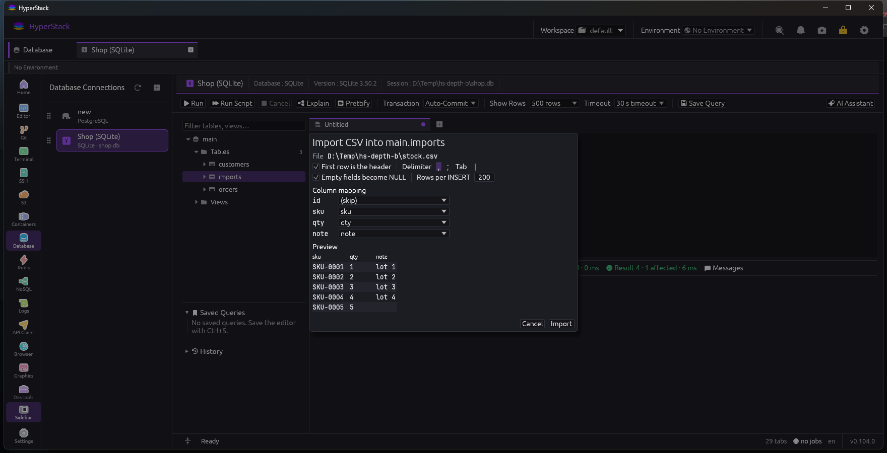 |  |
| **Import CSV** into a table — delimiter, header and NULL options, a preview and a column mapping, then batched INSERTs in one transaction as a Job; **Export** adds Excel (.xlsx) | **Connection** — paste a `postgres://` / `mysql://` / `sqlite:` URL; the password goes into the vault; TLS modes and an SSH tunnel through any SSH profile |
| 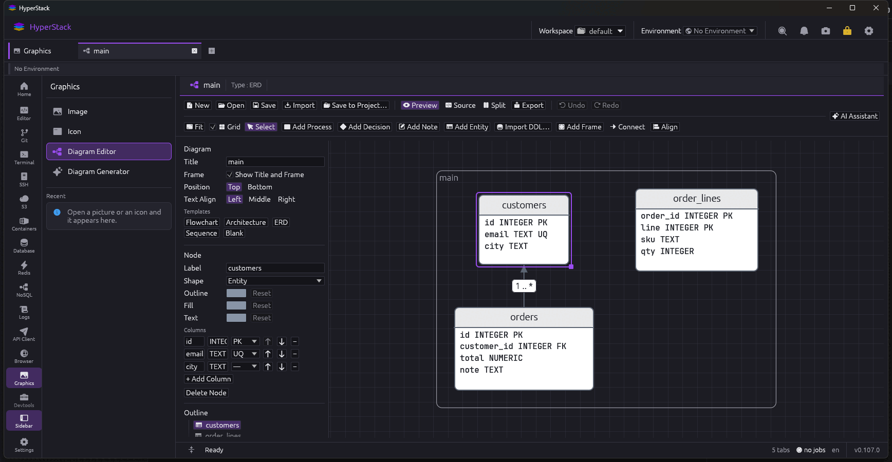 | 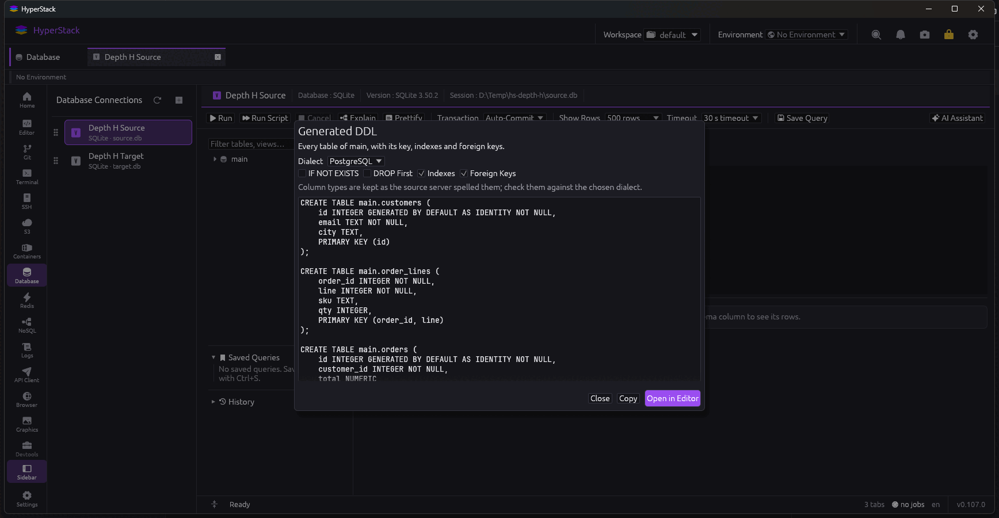 |
| **ER diagram** — the schema's tables and their foreign keys drawn as an ERD and opened in the Diagram Editor, columns badged PK / FK / UQ and the relationship's cardinality read from whether the key's own columns are unique; **Export** writes it as an SVG | **Generate DDL** — CREATE TABLE, CREATE INDEX and ALTER TABLE … FOREIGN KEY for a whole schema in any of the three dialects, whichever the source is, with IF NOT EXISTS, DROP first, indexes and keys each optional |
| 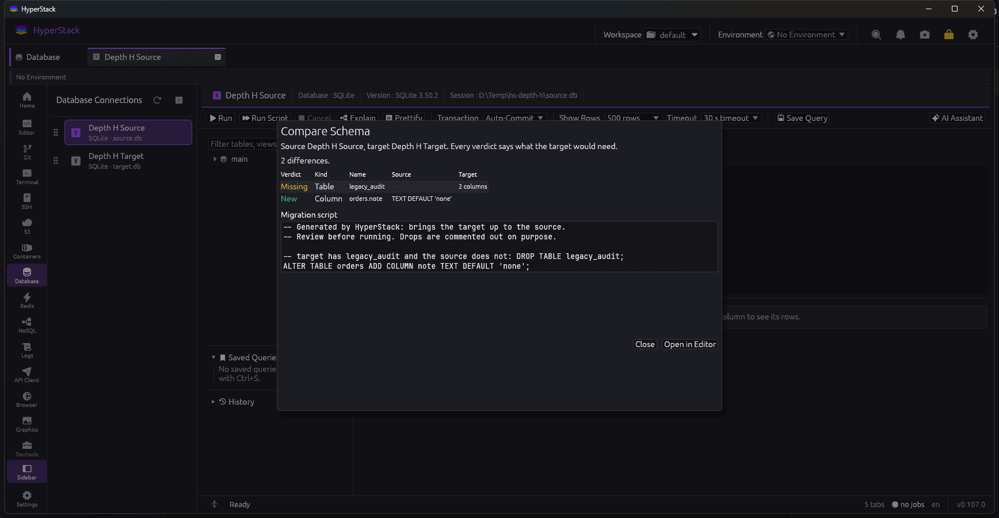 | 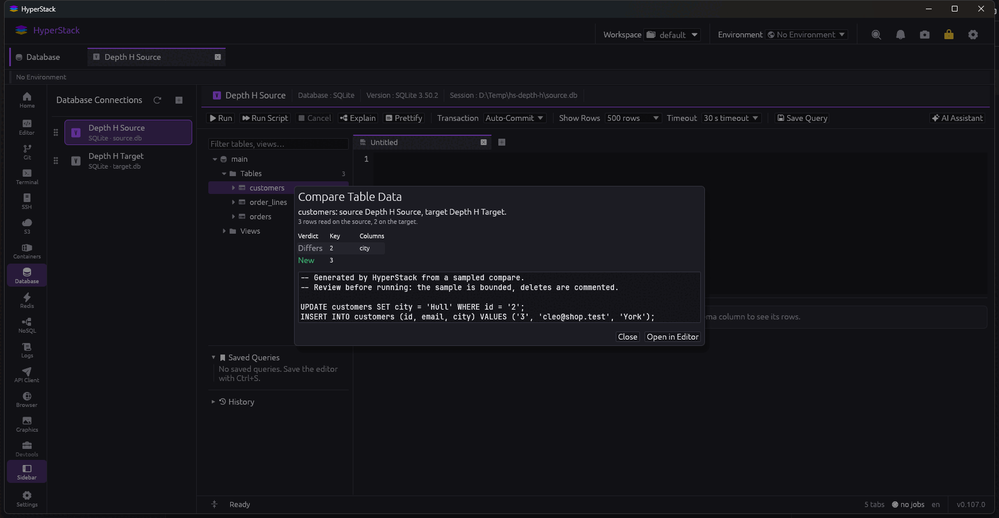 |
| **Compare Schema** against another saved connection — tables, columns, keys and indexes as New / Missing / Differs with both spellings side by side, and a generated migration whose additive steps are SQL and whose drops are commented out | **Compare Table Data** — one table sampled on both sides by primary key under a row bound, the rows that are new, missing or differ (with the columns that differ named), and generated INSERT / UPDATE with deletes left commented |

### Redis

| | |
|---|---|
|  | |
| **Keys** — SCAN-backed tree grouped by prefix with each key's type, a filter, and a type-aware viewer: hashes, strings, lists, sets, sorted sets and streams, with TTL and inline editing behind a confirmation. **Console** runs guarded commands; **Info** shows the server. Protected environments default to read-only | |
|  |  |
| **Console** - raw commands with history and completion, numbered replies and guards on a protected environment | **Info** - memory, clients, ops/s, hit rate, keys and uptime as cards with five-minute sparklines, role and persistence, and every raw INFO section folded under them |
| 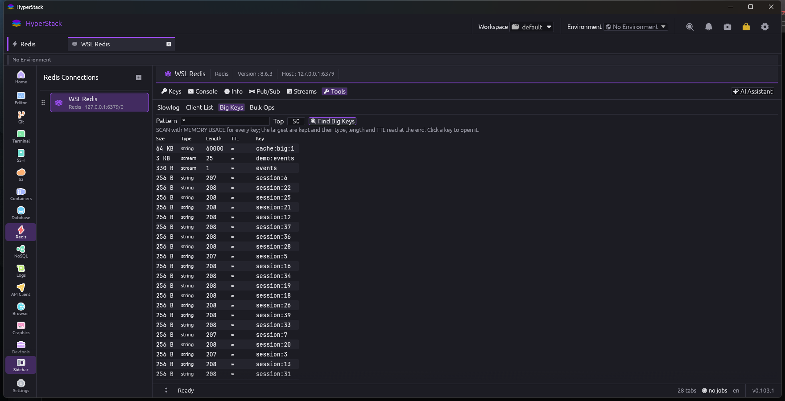 | 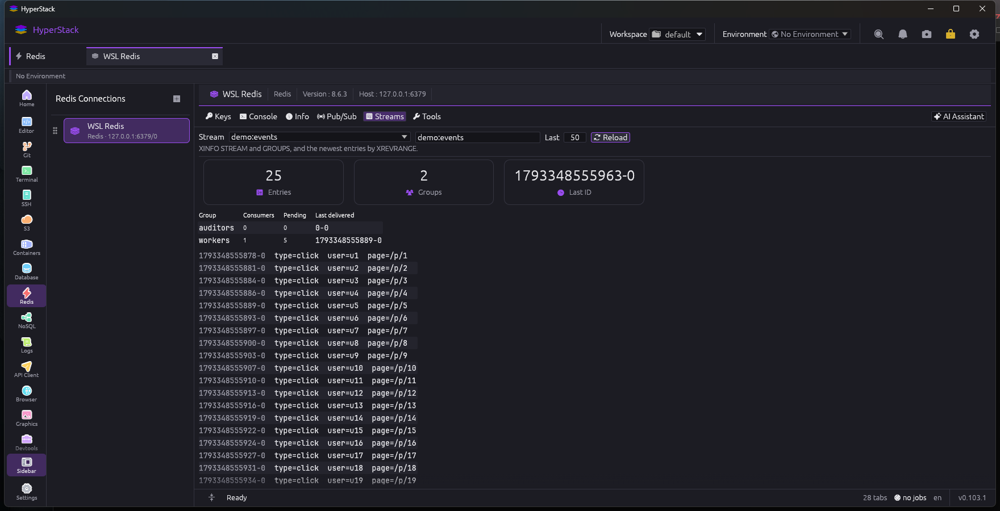 |
| **Tools** - Slowlog and Client List tables (kill is guarded), the **big-key finder** (SCAN + MEMORY USAGE, top N with type, length and TTL, cancellable) and **Bulk Ops** that preview the keys a pattern matches before delete / expire / persist / rename-prefix, with the pattern typed back on a protected environment | **Streams** - length, consumer groups with pending counts, last id and the newest entries; **Pub/Sub** subscribes to channels and patterns on a second connection and publishes |

### Logs

| | |
|---|---|
| 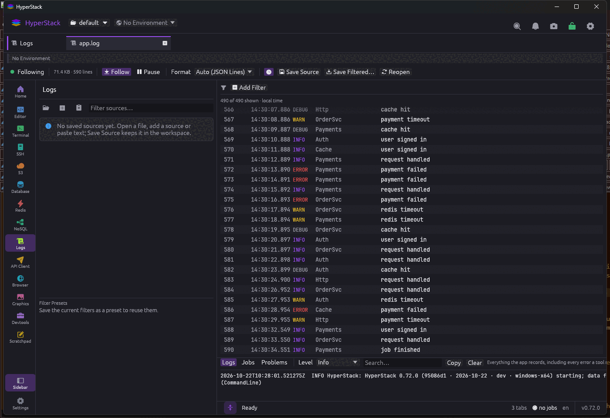 | 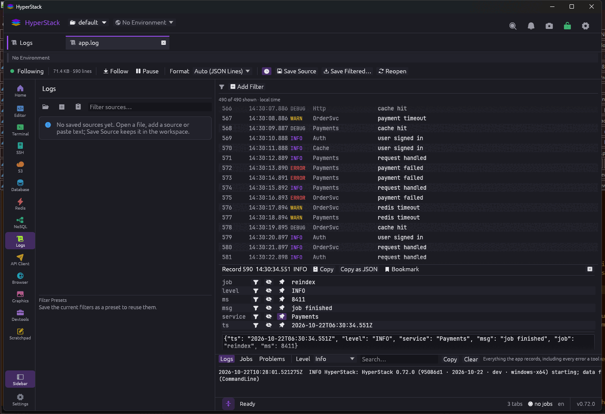 |
| **Sources** — a local file followed like `tail -F` (rotation noticed, multi-gigabyte files opened at their tail), a file on an SSH host through `tail -F` on an exec channel, any command's output (local or remote) and pasted text; saved sources grouped by environment in the sidebar, filter presets beside them | **Detail pane** — the record's fields with filter-by, exclude and pin-as-column actions, the raw line, Copy as JSON, bookmark and Open in Editor for `path:line` |
| 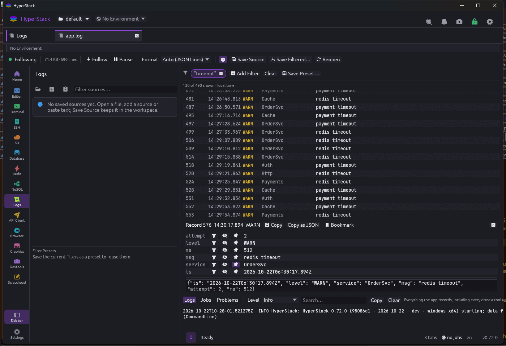 |  |
| **Parsers and filters** — plain, JSON lines, logfmt, syslog, Nginx/Apache, PostgreSQL and JVM thread dumps detected from the first lines, levels normalised, terminal colour codes stripped at ingest so a coloured container log is readable *and* parsable, stack traces glued to their line; a thread dump becomes one record per thread with its state, locks and top frame as filterable fields (**Open Thread Dump…**, or paste one); filter chips (text, regex, level ≥, field, time; negatable), highlight rules, Follow and Pause, Find, Jump to Time, bookmarks, Save Filtered… | **App log in the dock** — the bottom dock's Logs tab shows HyperStack's own log at the level set in Settings → General → Behaviour, with a level picker, search, Copy and Clear; every error a tool reports lands there too |
| 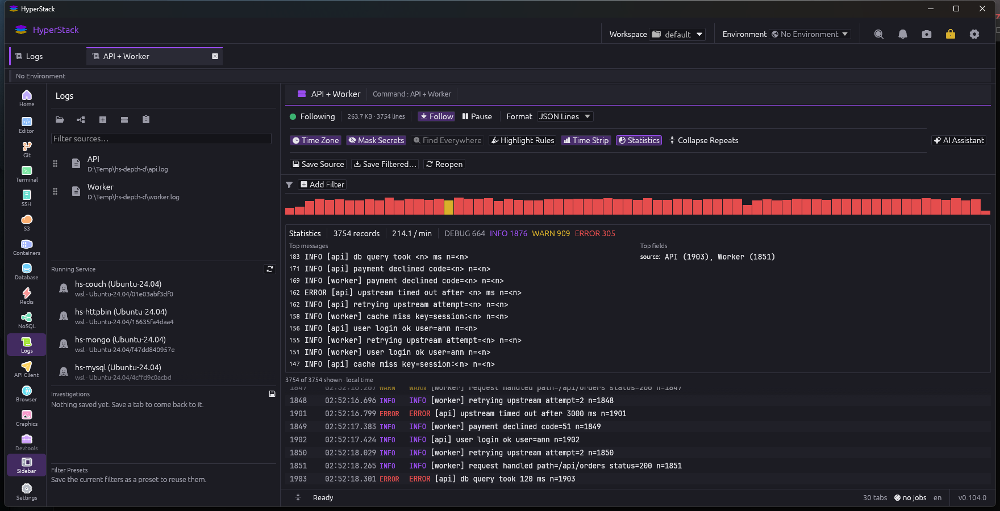 | 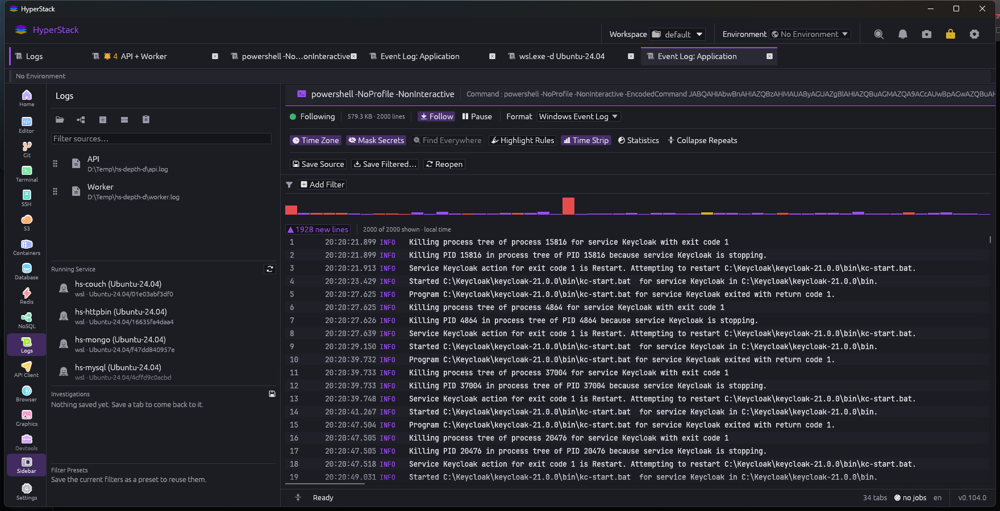 |
| **Merge and statistics** — several saved sources in one view in time order, each record tagged with its source; the Statistics panel counts the filtered window by level, rate per minute, commonest messages and field values; highlight rules can **Alert** (a toast in front, a bell count on the tab behind, with a cooldown) | **journald and the Windows Event Log** — `journalctl -o json` on this machine or an SSH host with the unit's fields kept, and the Event Log followed through `Get-WinEvent` with levels mapped |

### Automation

One tab per build server or automation controller: **Jenkins**, **TeamCity**, **GitHub Actions**, **GitLab CI**, **Forgejo Actions** and **AWX** (Ansible Automation Platform). The home tab is a dashboard of the saved servers with what the open ones are running and what failed today; Settings → Automation holds the servers and the limits.

| | |
|---|---|
| 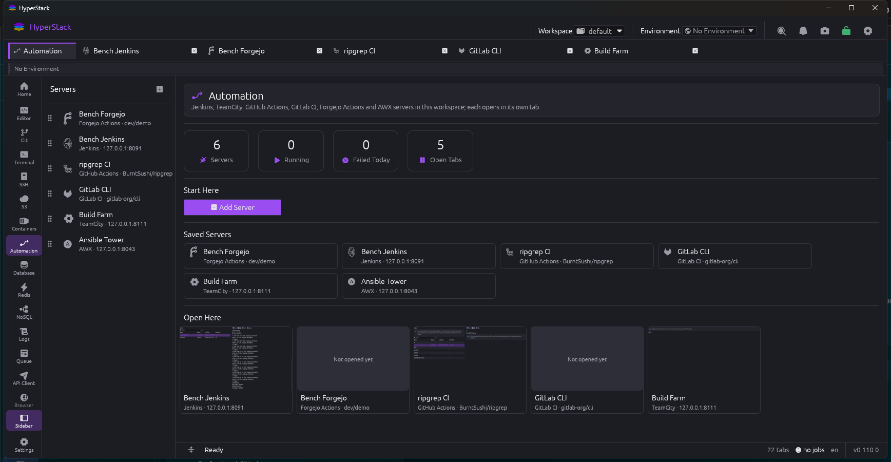 | 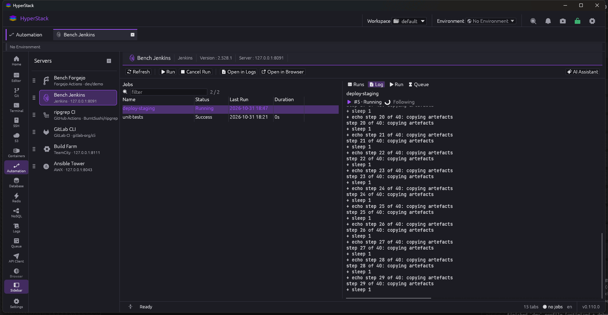 |
| **Dashboard** - saved servers with their products' marks, and totals from the servers open in tabs | **Runs and the log** - a job's runs with state, ref, duration and who, and the selected run's log followed while it runs |
| 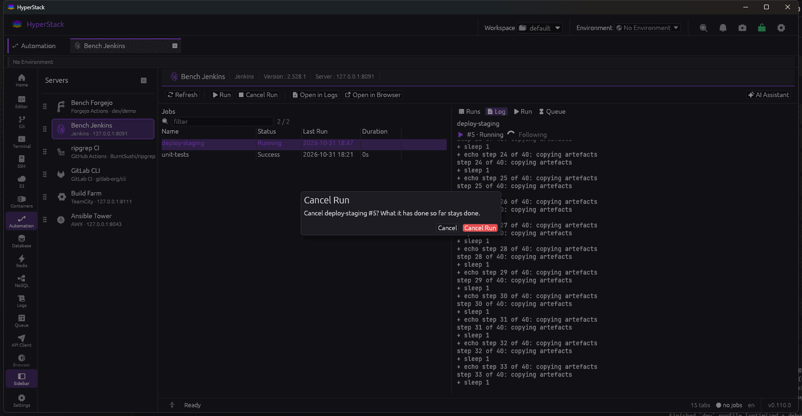 | 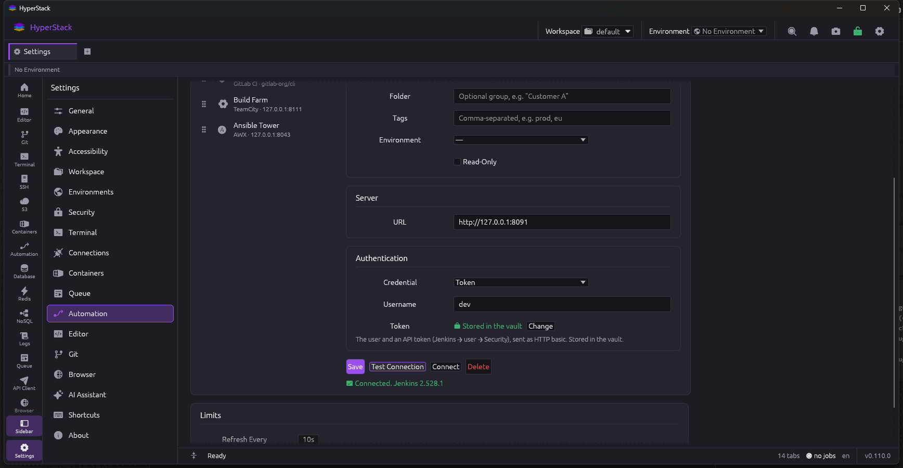 |
| **Guards** - Cancel asks first; a protected environment's tab is read-only and the driver refuses Run and Cancel too | **Settings → Automation** - a button per kind, and the credential the server takes (a Jenkins user and API token here), kept in the vault |

- **Jobs** - Jenkins jobs (folders flattened), TeamCity build configurations, workflows, a GitLab project's refs with pipelines, AWX job templates, each with its last run.
- **Run** opens a form of the job's parameters - Jenkins parameters, `workflow_dispatch` inputs read from the workflow file, GitLab pipeline variables, AWX survey and extra vars - and sends nothing until it is filled in; a secret parameter is typed for one run and never kept.
- **Log** follows a running build every 2 s from where it got to; **Open in Logs** hands it to the Logs activity; **Open in Browser** opens the run on the server's own page.
- **Credentials** - username and password, token or API key, whichever the server takes, in the vault.

### Queue

One tab per message broker: **RabbitMQ** (through its management API), **Kafka**, **Redis Streams**, **NATS** JetStream and **MQTT** 3.1.1 / 5. The home tab is a dashboard of the saved brokers with totals from the open ones; Settings → Queue holds the brokers and the limits.

| | |
|---|---|
| 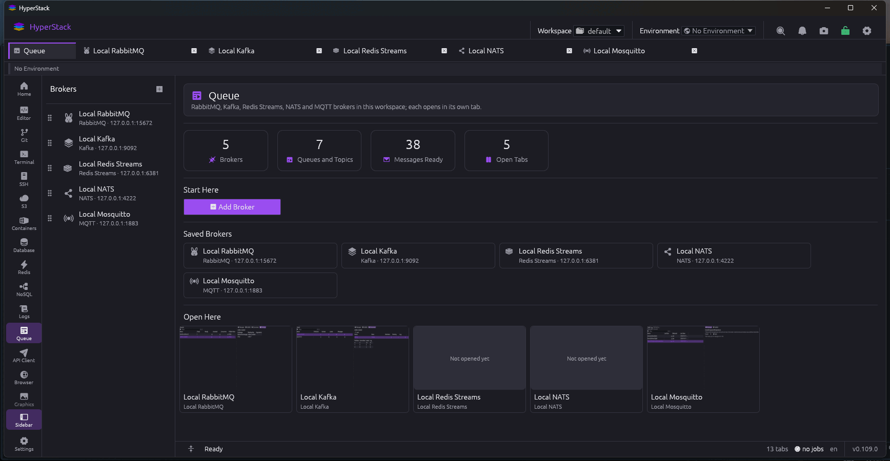 | 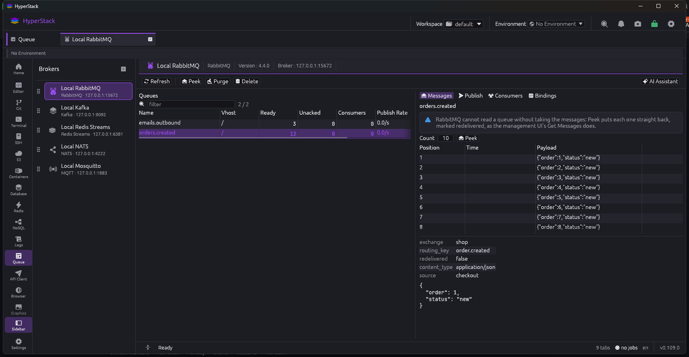 |
| **Dashboard** - saved brokers, and totals of queues, topics and ready messages from the brokers open in tabs | **Peek** - a RabbitMQ queue read without losing its messages: the requeue is stated first, then headers, properties and the body |
| 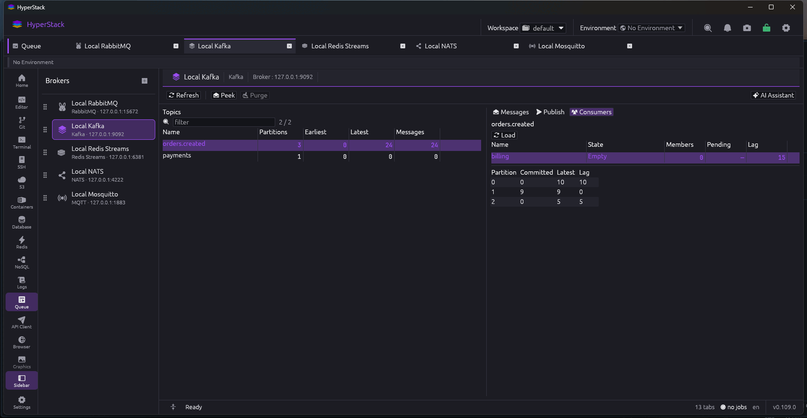 | 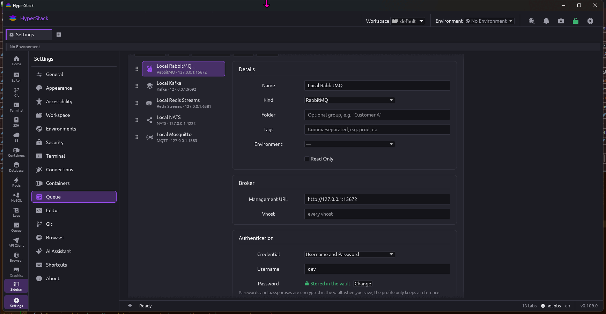 |
| **Consumer lag** - a Kafka group's lag per partition; the profile is read-only, so Purge is disabled | **Settings → Queue** - one button per broker kind, the brokers list, and a credential of whichever kind the broker takes, kept in the vault |

- **Destinations** - queues, topics or streams with the figures their kind has (RabbitMQ ready / unacked / consumers / rates per vhost, Kafka partitions and offsets, a stream's length and groups, NATS messages and consumers, and for MQTT the topics seen during a bounded look at `#`), refreshed while the tab is on screen.
- **Peek** reads up to 50 messages (1 MB) without consuming them, JSON pretty-printed and binary shown as hex with its headers; RabbitMQ can only read by requeueing, and the pane says so before the first peek.
- **Publish** to the selected destination with headers, a routing key or record key, a partition, or QoS and retain.
- **Consumers** - Kafka groups with lag per partition (cancellable, with progress), Redis stream groups with pending and lag, NATS consumers, RabbitMQ consumers; **Bindings** for a RabbitMQ queue.
- **Guards** - Purge asks first, Delete asks for the name to be typed, and a protected environment's tab is read-only with the driver refusing writes too.
- **Credentials** - username and password, token or API key, whichever the broker takes, in the vault; Kafka SASL PLAIN, SCRAM-SHA-256/512 and OAUTHBEARER.

### NoSQL (MongoDB and CouchDB)

| | |
|---|---|
|  | |
| **Containers** — databases and collections (MongoDB) or databases and document counts (CouchDB); a collection opens in **Find** with filter, projection and sort, the documents as a table and a JSON editor with delete/update guards; **Aggregate** and **Indexes** are beside it | |
|  | |
| **Aggregate** - a JSON pipeline with a page limit, previewed as a table or JSON; **Indexes** lists each collection's indexes | |

### API client

| | |
|---|---|
|  |  |
| **Requests** — method, URL with `{{variables}}`, params, headers, body (JSON, text, XML, form, multipart, binary), auth (inherit, basic, bearer, API key); response as pretty, raw or preview with headers, cookies, tests and console; Copy as curl, Import curl; history | **Scripts** — pre-request and post-response JavaScript with the `pm` API (`pm.environment`, `pm.globals`, `pm.collectionVariables`, `pm.request`, `pm.response`, `pm.test`, `pm.expect`, `console`), snippets, collection libraries; Postman v2.1 collections and environments import and export |
|  | 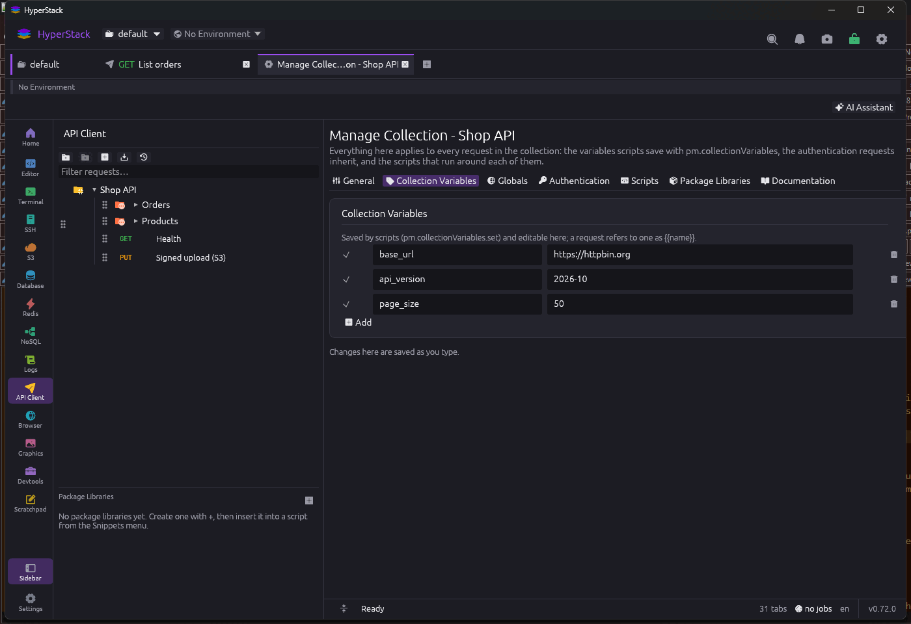 |
| **Assistant that fills the client** — ask for a collection, a request, headers, a body, auth, scripts or docs; the answer's `hs-api` block gets **Apply**, which edits the open request and the collections exactly as the sidebar would. Nothing is sent until you press Send | **Manage Collection** — one tab per concern: General, Variables (edit key and value in place), Globals, Authentication, Script, Package Library and Documentation; changes save as you type |
| 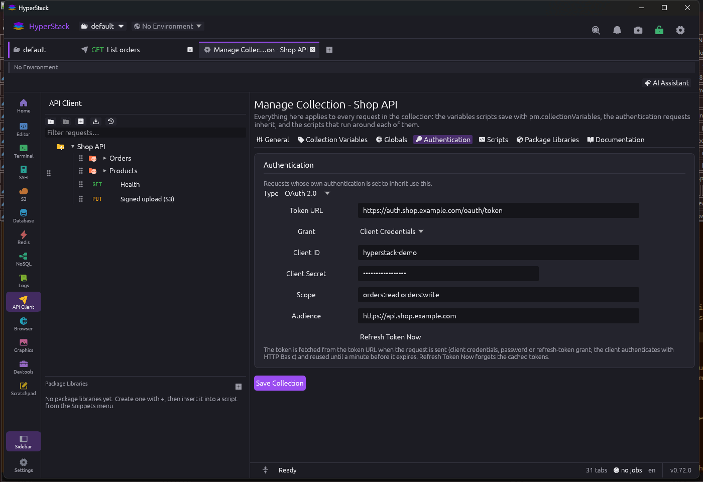 | 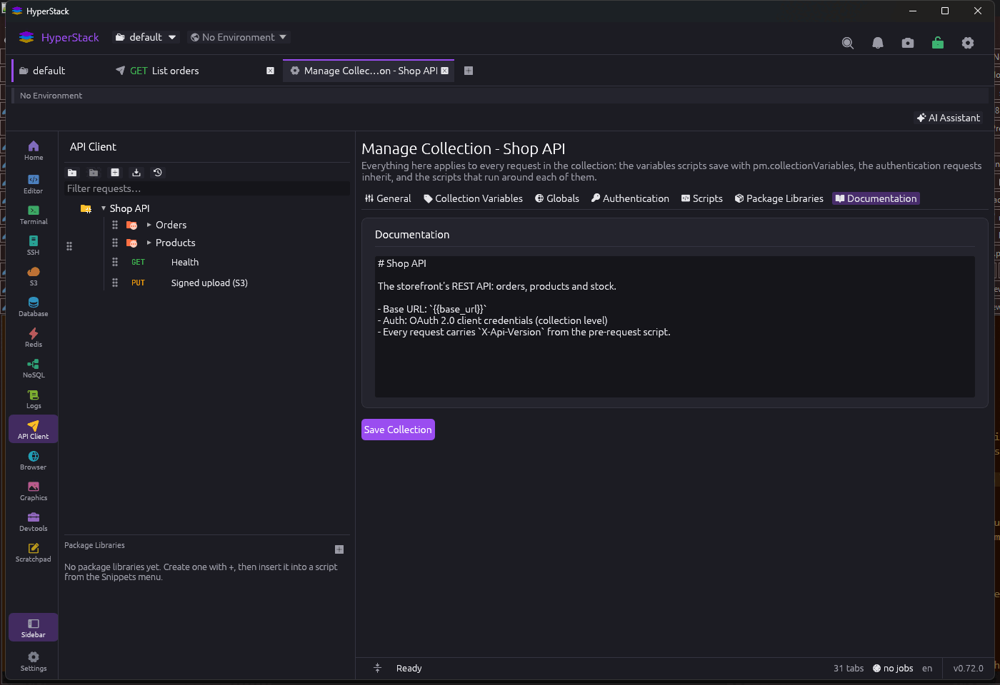 |
| **Authentication** — inherit, none, Basic, Bearer, API key, **OAuth 2.0** (client credentials, password and refresh-token grants, token cached until it expires) or **AWS Signature V4** at the collection, folder or request level | **Documentation** — Markdown for the collection, rendered beside the editor |

Collections are JSON files in the workspace; variables resolve through the
collection, the active environment (vault secrets only when sending) and
globals. A non-GET request to a protected environment asks first.

### Devtools

| | |
|---|---|
|  |  |
| **JWT** — decode with claim explanations and expiry, verify with a secret or public key, sign for testing (HS256/384/512, RS256/384/512, ES256); the secret can be saved to the environment (vault) and the `{{reference}}` peeked | **Hashes** — MD5, SHA-1/2/3, BLAKE3, CRC32 of text or a file, HMAC, hex or Base64, compare field |
|  |  |
| **Jasypt** — `PBEWithMD5AndDES` and `PBEWITHHMACSHA512ANDAES_256` property encryption with jasypt's salt/IV layout and `ENC(…)`, plus the legacy DES/AES/MD5 DataEncryptor | **PKI messages** — sign with RSA and encrypt with AES-256-GCM under a shared key derived from a device id, then decrypt and verify, for both request and response flows |
| 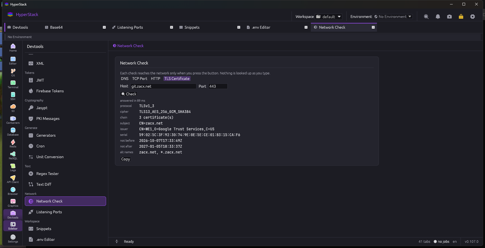 | 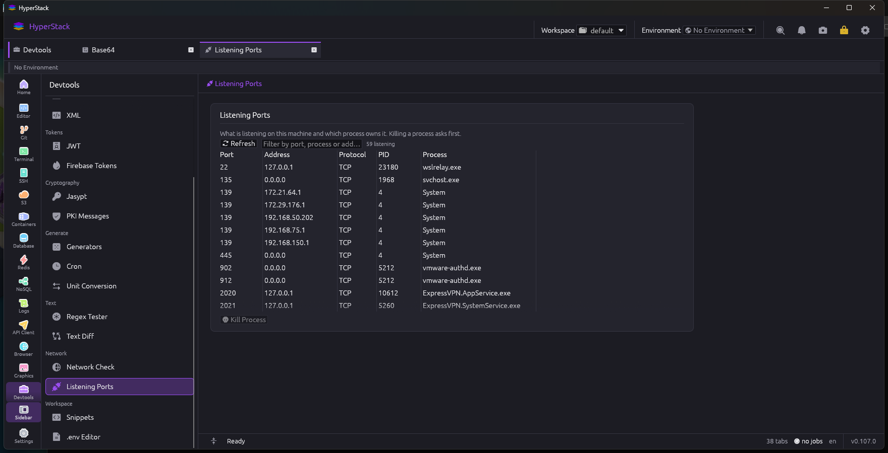 |
| **Network Check** - a DNS lookup (A, AAAA, CNAME, MX, TXT, NS), a TCP connect check with its timing, an HTTP check with status, timing and headers, and a TLS certificate viewer with the chain, validity and alternative names | **Listening Ports** - what is listening here with the owning process and PID, filtered, with a guarded Kill Process; **Snippets** keeps code, SQL and shell with the workspace, and the **.env editor** masks secret-looking keys |
|  |  |
| **Regex Tester** — a pattern with flags, every match with its groups and positions, and the text with matches marked; the same engine as the app's filters | **Text Diff** — two texts side by side, changed lines marked, whitespace-insensitive mode, copy as a unified diff |
|  |  |
| **Base64** - auto-detected text, pictures and documents, data URIs and Basic auth headers; the decoded text with a hex dump | **URL** - Component, Full URL or Form encoding, a parts table and strict mode |
|  |  |
| **YAML** - check with line-numbered problems and convert to and from Java `.properties` | **Generators** - UUID v4/v7/Nil, numbers, passwords and passphrases with a seed and entropy |
|  |  |
| **Cron** - build a schedule and read it in Unix, Spring and Quartz dialects, with an expression checker | **Units** - time, epochs, number bases, data sizes, durations and bandwidth, with every unit listed |

| 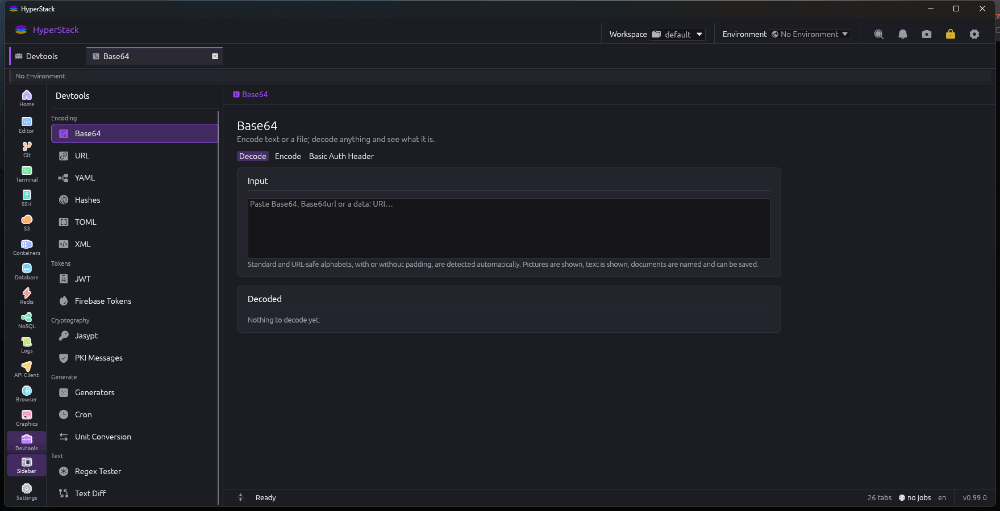 | |
| **Utility tabs** (2026-10-29) - every utility opens in its own tab under a toolbar row that names it and keeps the hard-right corner for an AI Assistant control; the activity's dashboard lists all fifteen | |

Also **TOML** and **XML** (check, format, convert) and **Firebase tokens**;
keys typed into a utility are never saved.

### Graphics

| | |
|---|---|
|  |  |
| **Graphics activity** — the sidebar lists Image, Icon, Diagram Editor and Diagram Generator plus a scrollable Recent section; the permanent first tab is a dashboard with “What To Do”, the function list and a screenshot grid of the open Graphics tabs | **Image tab** — the picture keeps the tab, the operations and settings sit on the left and the preview on the right; **Convert to Icon** opens the result in a new Icon tab |
|  |  |
| **Icon tab** — the same operations plus ICO frame selection, sizes and colour-key transparency; here the blue background was picked on the canvas and cleared, leaving the label | **Crop placeholder** — Select on Canvas shows a rectangle with grips; move it, resize it by an edge or corner, or draw a new one, and the X/Y/W/H boxes follow |
|  |  |
| **Diagram Editor** — the flowchart template on the canvas with the Diagram panel, Outline, shape picker and undo/redo; nodes can be selected, moved and connected, and the same scene exports as SVG, PNG or PDF | **Architecture template** — the grid with a VPC boundary, database cylinder and labelled async links; the properties panel shows the selected component |
|  |  |
| **Diagram Generator** — type picker, prompt, examples, Use Template and Generate; with no AI provider the offline template is a real result and the message says so | **Same scene, exported** — the generator’s preview is the editor’s scene and the SVG/PNG/PDF writer, so the export matches the screen |
| 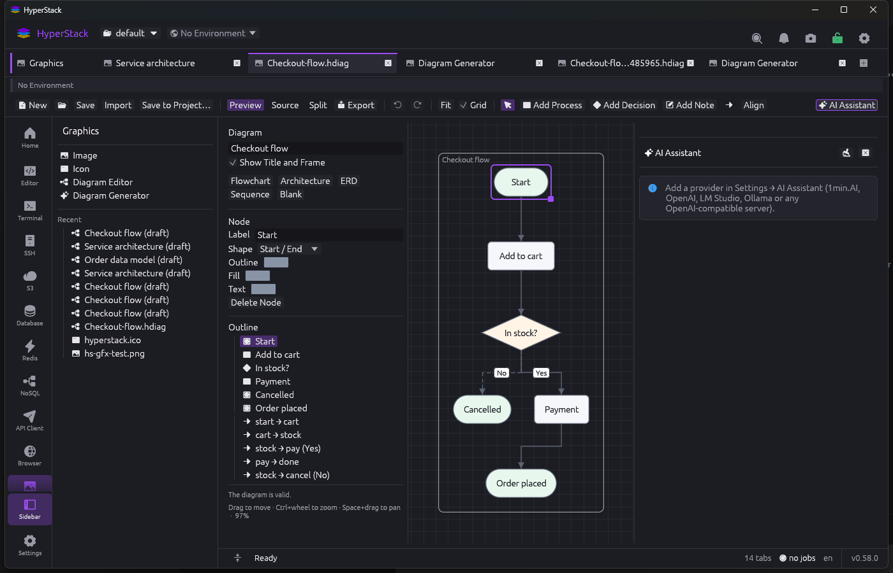 | 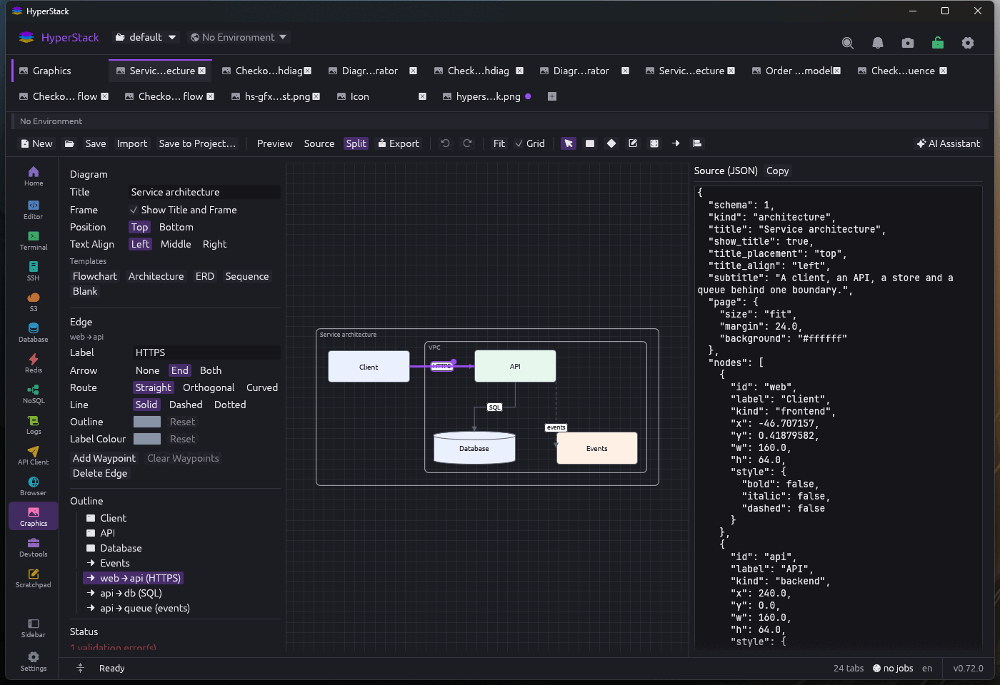 |
| **AI Assistant column** — a fixed right pane, with the title frame around the diagram and a frame resize grip | **Source and Preview** — Split puts the live JSON to the right of the canvas |
|  |  |
| **Proper node shapes** — the database is a cylinder, decisions are diamonds and the Outline carries a shape icon for every node | **Save to Project** — pick an open Editor project, keep `docs/diagrams`, name the file and confirm an overwrite |
| 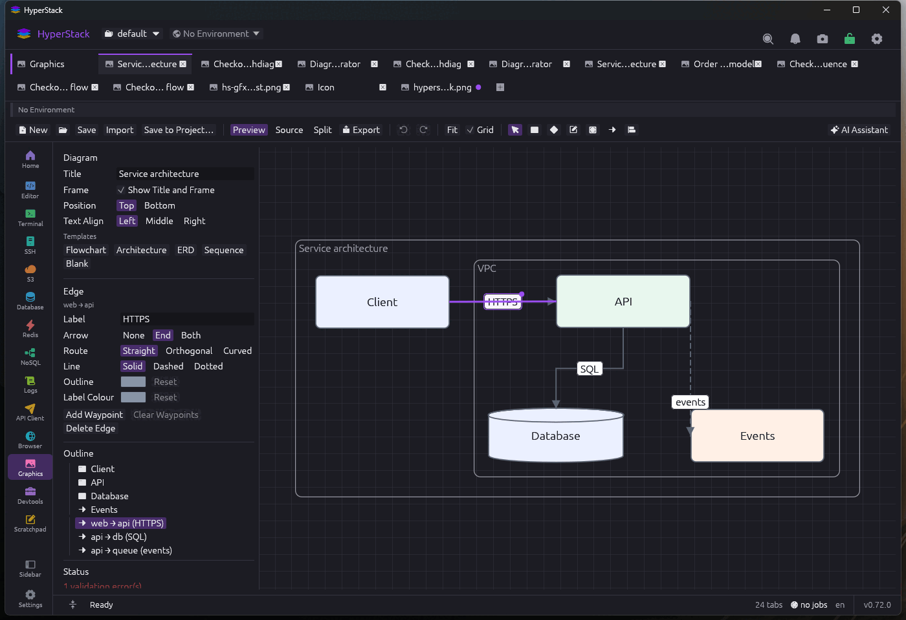 | 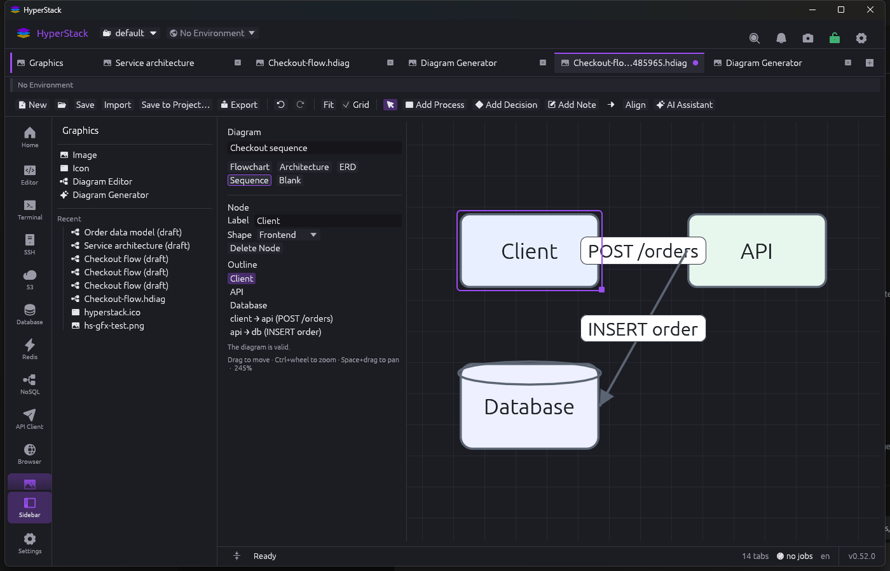 |
| **Edge editing** — select an edge from the Outline to edit its label, arrow, route, dashed or dotted line, waypoints and deletion | **Sequence template** — Client, API and Database with labelled request and insert messages |

**Implemented (2026-10-20):** the activity shell, the dashboard and Recent
list, the separate Image and Icon tabs, Convert to Icon and icon colour-key
transparency. The `hs-diagram` core is in place: the `.hdiag` model and strict
Archify-adapted IR, validation, deterministic flow/architecture layout,
routing, a shared scene, and SVG/PNG/PDF export. The **Diagram Editor** renders
that scene on a pannable/zoomable canvas, with selection, node dragging, adding
shapes, connecting, undo/redo, the properties panel, templates and save/export.
The editor saves into an open project's `docs/diagrams/` folder through a
Save to Project dialog and autosaves a draft while typing. The canvas has
resize grips, Shift-click multi-select align/distribute, edge label and
waypoint editing, and Import for Archify JSON and plain or compressed draw.io XML. The **Diagram
Generator** turns a prompt into the strict IR through the
configured AI provider, falls back to the offline template, validates the
result, previews it and opens it in the editor. The review-only **AI
Assistant** is available in all four tools with four quick actions each,
More Suggestions and text-only context for the diagram and generator. The
repair round and drafts follow in the same release; ERD, sequence, Archify JSON
and draw.io XML import follow in Release 2. About → Third-Party Notices
lists the bundled third-party work, including the Archify schema adaptation.
See [docs/tools/diagrams.md](docs/tools/diagrams.md).

The picture operations are resize, scale, extend canvas, crop, rotate, flip,
brightness, contrast, hue, saturation, grayscale, invert, blur and sharpen,
each removable; the AI assistant is review-only.

### Scratchpad and assistant

| | |
|---|---|
|  |  |
| **Notes** — a collection of Markdown notes per workspace: the sidebar lists them newest first with pinned notes on top, one tab per note, source and preview side by side, saved 1.5 s after typing stops | **Assistant** — drafts checklists, tables, Mermaid diagrams and command fences; each block inserts at the cursor |
|  | 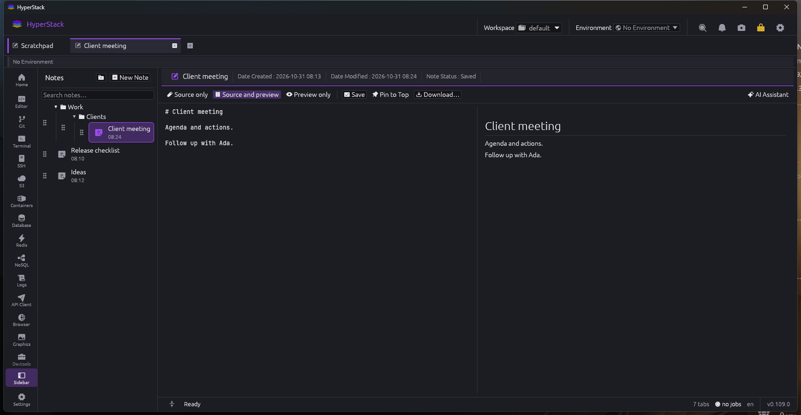 |
| **Pinned notes** - right-click a note to pin it above the rest; source and preview share the pane and save a moment after typing stops | **Folders** — notes filed in folders and subfolders at any depth, each a real directory; drag a note by its grip to reorder it or onto a folder to move it in, a taken name gets ` 001`, folders stay collapsed across a restart, and search and Ctrl+P show the folder a note is in |
|  | |
| **Dictate to any assistant** — the microphone beside Send runs the operating system's own speech recognition (offline); phrases are typed into the box, a stop keeps the phrase in flight, the session ends on its own after a set time, and nothing is sent until you press Send | |

### Browser

| | |
|---|---|
|  | |
| **Browser** — WebView2 pages in multi-row tabs, with favourites and saved logins in the sidebar: address bar with search fallback, back/forward/reload/home, per-page ad and tracker blocking, JavaScript switch, forced dark rendering, zoom, Inspect, Print; pages restored per workspace; Shift+click a terminal link to open it here (Windows) | |
|  |  |
| **Favourites** - a per-workspace tree with folders and a bar under the address bar, Chrome's click rules; the star adds the open page | **Passwords** - per-workspace logins; username, password, passkey and API key live in the vault, and Fill in Password is in the toolbar |

### Settings

| | |
|---|---|
|  |  |
| **General** — startup workspace, restore tabs, language; export and import settings and shortcuts behind the master password | **Appearance** — System / Dark / Light mode with a scheme for each (clickable swatches), interface font and size, UI zoom, plain or coloured activity icons, tab widths, rail labels, and the rail's order and visibility per workspace (pick the workspace, the change applies to it at once) |
|  |  |
| **Accessibility** — Read Aloud through the OS voice, speech rate, reduce motion | **Workspace** — rename, logo, folder, compare environments with another workspace and copy the missing ones |
|  |  |
| **Environments** — colour, inheritance, protected flag; variables edited in place; **Import…** merges Postman/Insomnia/Bruno JSON and **Export…** writes Postman, Insomnia, Bruno or Flat JSON (secrets omitted) | **Security** — unlocked vault, relock and clipboard timers, and the credentials table: masked passwords, **Reveal Secret** and **Edit Secret** in the Action column |
|  |  |
| **Edit Secret** — after the master password, the password and key are editable; typed values move into the vault, an empty field clears the secret | **Connections** — every profile by kind, folder and tags, drag to reorder, Test Connection and **Connect**, which saves and opens the profile in its own activity. Right-click a connection in any activity sidebar for **Edit This Connection…**, which opens its form here |
|  |  |
| **Terminal** — default shell, font, right-click copy/paste, link detection; the Terminal List with its CLI editor beside it | **Editor** — the Project List with its form beside it (list left, form right, as every list on a Settings page is laid out since 2026-10-30), then font, right-click, trim and final newline on save, auto reload, language servers and debug adapters |
|  |  |
| **Terminal List** - shells and CLI profiles in order, with Add CLI, Edit, Remove and PATH suggestions (sqlite3, claude and opencode here); a disabled CLI stays in the list and leaves the sidebar | **Git** (2026-10-29) - Repositories (master/detail, Fetch Project, Clone and Save, uploaded icons), Git Credentials (tokens in the vault, Test) and General (protected patterns, pull / sign-off / stash options, clone folder, terminal profile, Git Flow names) |
| 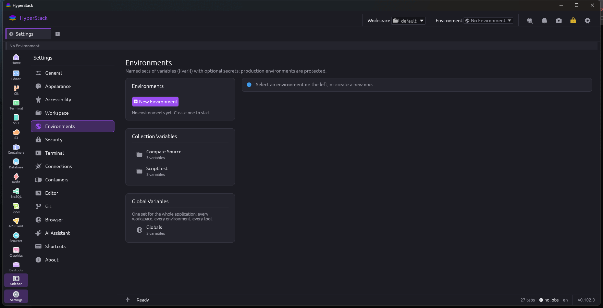 | 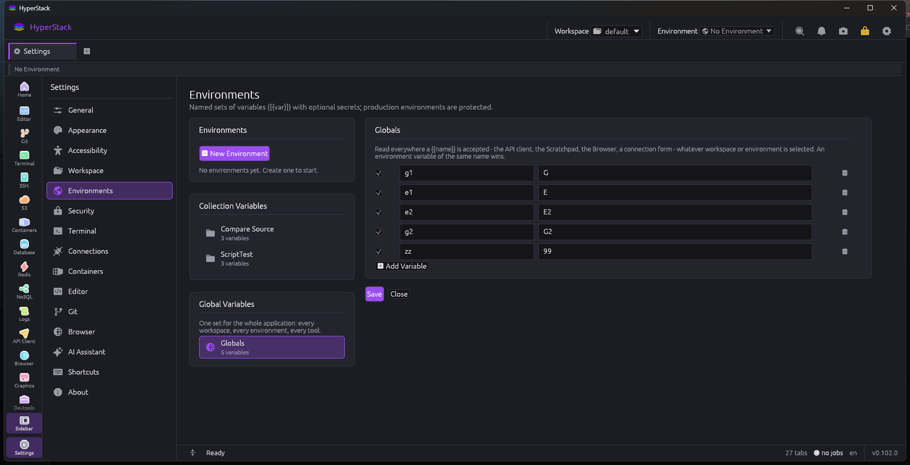 |
| **Collection Variables and Global Variables** (2026-10-29) - beside the environments, every API collection's variables and the one application-wide global set, edited in place; a collection's **Compare With…** shows New / Same / Differs against another collection in this or any other workspace, with Copy Selected and **Sync All** | **Globals** - one set for the whole application, read wherever a `{{name}}` is accepted (API client, Scratchpad, Browser, connection forms); an environment variable of the same name wins |
|  |  |
| **Browser** — home page, blocking and script defaults, extra blocked hosts | **Shortcuts** — every action rebindable; conflicts listed |
|  |  |
| **AI providers** — chat: Anthropic, Google Gemini, Azure OpenAI, AWS Bedrock, 1min.AI or any OpenAI-compatible server; images: 1min.AI or a self-hosted AUTOMATIC1111 / SD.Next / Forge, ComfyUI, SwarmUI, InvokeAI or Fooocus server, with cards for the shared workflow, for Upscale (model, and a ratio or a target size) and for Enhance (refiner and face restorer, never a resize); add one from a gallery grouped by capability, keys in the vault | **About** — installed version, update channel, Check Now, release notes, data folder |

Every tab can be **snipped** to a PNG (Ctrl+Alt+S, camera menu) or
**printed** (Ctrl+Alt+P) as an HTML page with a Light/Dark switch that
opens in your browser: code with its highlighting, the Markdown preview,
a query with its result table, a console screen, an S3 listing, a request
with its response, a picture.

## Why

A typical day for a backend developer touches VS Code, DBeaver, Postman, WinSCP,
PuTTY, Cyberduck, a Git GUI, Docker Desktop and three browser tabs of JWT /
JSON / cron utilities. Each tool keeps its own connection list, its own secrets,
its own idea of "staging vs production", its own theme and its own update
nagging. HyperStack's bet: **the connections, environments and secrets are the
product**, and the tools are views over them.

## Stack (decided)

| Layer | Choice | Why |
|---|---|---|
| Language | **Rust** (edition 2024) | Native speed, single portable binary, same ecosystem the author already knows from Eden Explorer |
| GUI | **egui / eframe 0.35** | Immediate-mode, proven by Eden Explorer for this kind of UI, fast tables and custom widgets, no web runtime |
| Async | **tokio** runtime on background threads, channels to the UI thread | Network tools (HTTP, SSH, DB drivers) are async-first |
| Distribution | **Portable by default on Windows**: one `HyperStack.exe`, all settings and data in a `HyperStackData/` folder beside it; no installer, no registry, no `%APPDATA%` | Run from a USB stick or a tools folder, move or back up by copying the folder |
| Storage | Human-readable TOML/JSON files for shareable things + SQLite for history/cache | Collections and profiles can live in git; history stays local |
| Secrets | Encrypted vault file beside the executable (master password, Argon2id + XChaCha20-Poly1305); OS keyring optional | Portable and never a plaintext password on disk |
| Platforms | Windows first-class, Linux and macOS supported from day one | DevOps and DBAs are often not on Windows |
| Delivery | Forgejo Actions on `git.zacx.net` plus a public GitHub mirror that shares the same history and version numbers: CI on every branch, automatic SemVer release on `main`, signed `manifest.json`; each copy updates itself from the forge it was downloaded from (Settings → Updates) and can revert once | Portable copies stay current without an installer, from either source |

Full reasoning in [docs/08-decisions.md](docs/08-decisions.md).

## Documents

| # | Document | What it covers |
|---|---|---|
| 01 | [Vision and scope](docs/01-vision-and-scope.md) | Problem, personas, principles, non-goals, success criteria |
| 02 | [Feature catalogue](docs/02-features.md) | Every feature, requested or suggested, with priority and effort |
| 03 | [Architecture](docs/03-architecture.md) | Crate layout, runtime model, the `Tool` trait, services, events, persistence |
| 04 | [UI design](docs/04-ui-design.md) | Window layout, multi-row tab space, launcher, command palette, keyboard, theming |
| 05 | [Data model and storage](docs/05-data-model-and-storage.md) | Workspaces, connection profiles, environments and variables, file formats, history DB |
| 06 | [Security](docs/06-security.md) | Threat model, secrets, host keys, TLS, destructive-action guards |
| 07 | [Roadmap](docs/07-roadmap.md) | Phases, milestones, checklists, effort estimates |
| 08 | [Decisions (ADRs)](docs/08-decisions.md) | Why egui and not Tauri, why hybrid Git, why not sqlx, portable-first, and so on |
| 09 | [CI/CD, releases and in-app updates](docs/09-ci-cd-and-updates.md) | Forgejo workflows, automatic versioning, signed release manifest, Settings → Updates (check, download, verify, install, revert), the public GitHub mirror (§10) |
| 10 | [Depth programme](docs/10-depth-programme.md) | The Phase 2 / 3 items re-planned on 2026-10-30 as fifteen phases: Redis, SQL, SQL engines, Logs, SSH, S3, Devtools, SQL compare / ERD, Cassandra, forge integration, an Automation activity, a Queue activity (RabbitMQ, Kafka, …), ELK (Elasticsearch / Kibana), a Tracker activity (Jira, Redmine, GitLab, Confluence, …), Scratchpad folders |
| — | [Workflows](.forgejo/workflows/) and [release scripts](scripts/) | Active Forgejo Actions (`ci.yml`, `release.yml`), their GitHub counterparts in [.github/workflows/](.github/workflows/) and the PowerShell scripts both run; [keys/](keys/) holds the release-signing public key |
| — | [Tool specs](docs/tools/) | One design document per tool (editor, SQL database, NoSQL, Redis, logs, API client, SSH/SFTP, S3, Git, terminal, containers, devtools) |

## Tool specs

| Tool | Spec | MVP? |
|---|---|---|
| Code editor | [tools/editor.md](docs/tools/editor.md) | Yes |
| Database client | [tools/database.md](docs/tools/database.md) | Yes |
| Redis cache viewer | [tools/redis.md](docs/tools/redis.md) | Yes |
| NoSQL / document DB client (MongoDB, CouchDB, Elasticsearch, DynamoDB, …) | [tools/nosql.md](docs/tools/nosql.md) | Yes (MongoDB, CouchDB) |
| Log tail viewer | [tools/logs.md](docs/tools/logs.md) | Yes (local + SSH sources) |
| API client (REST / WebSocket / GraphQL / gRPC) | [tools/api-client.md](docs/tools/api-client.md) | Yes (REST) |
| SSH + SFTP | [tools/ssh-sftp.md](docs/tools/ssh-sftp.md) | Yes |
| S3 browser | [tools/s3.md](docs/tools/s3.md) | Yes |
| Git | [tools/git.md](docs/tools/git.md) | Yes |
| Terminal | [tools/terminal.md](docs/tools/terminal.md) | Yes |
| Containers (Docker / Podman / Kubernetes) | [tools/containers.md](docs/tools/containers.md) | Yes (Docker/Podman with Compose and Swarm; Kubernetes: pods, workloads, services, config, nodes, events, custom resources, YAML, pod logs, restart/scale/delete, apply with a server-side dry-run diff, port forward); an AI assistant with twelve prompt buttons, manifest and action blocks, and unhealthy objects in the Problems inbox |
| Devtools drawer (JSON, JWT, regex, cron, diff, …) | [tools/devtools.md](docs/tools/devtools.md) | Completed (core set; JSON query and the P1 extras remain) |
| Graphics | [tools/graphics.md](docs/tools/graphics.md) | Yes |
| Graphics diagrams (editor and generator) | [tools/diagrams.md](docs/tools/diagrams.md) | Planned (R1: flowchart, architecture) |
| Scratchpad | [tools/scratchpad.md](docs/tools/scratchpad.md) | Yes |
| Browser | [tools/browser.md](docs/tools/browser.md) | Windows |

## Build and run

```bash
cargo build --release -p hyperstack          # target/release/HyperStack.exe (static MSVC build)
./target/release/HyperStack.exe --version
./target/release/HyperStack.exe --self-test --data-dir ./tmp-data
./target/release/HyperStack.exe --data-dir ./tmp-data   # run against a scratch data folder
cargo clippy --workspace --all-targets --locked -- -D warnings && cargo test --workspace --locked
HS_S3_ENDPOINT=http://127.0.0.1:5055 cargo test -p hs-core --test s3_live   # S3 client against moto_server or MinIO
# SQL drivers: SQLite always; PostgreSQL / MySQL when given host:port:user:password:database
HS_PG=127.0.0.1:5432:postgres:pg:postgres HS_MYSQL=127.0.0.1:3306:dev:dev:shop cargo test -p tool-db --test drivers
```

On Linux, `cargo clippy --workspace` also needs `libwayland-dev`,
`libxkbcommon-dev` and `pkg-config` (the UI test harness builds the Wayland
backend).

### Running on a Mac via Parallels (beta testing)

There is no macOS build yet, but the Windows build runs in a Windows VM on
a Mac and that is enough to try the product. The UI renders through
**wgpu**, so it uses Direct3D, which Parallels accelerates properly — an
OpenGL-only app would be the awkward case here and this is not one.

- **Intel Mac**: Parallels runs x64 Windows natively. Nothing special.
- **Apple Silicon**: Parallels can only run **Windows 11 ARM**, so
  `HyperStack.exe` (x86-64) runs under Windows' x64 emulation. That works,
  with one caveat worth knowing before you report it as a bug: the
  **Browser activity needs the x64 Edge WebView2 Runtime**. ARM Windows
  ships the ARM64 one, which an emulated x64 process will not load, so the
  browser tab comes up blank until the x64 runtime is installed. Every
  other activity is pure Rust and emulates without help. Expect perhaps
  20–40% less CPU speed, which is invisible in the UI.

**This tests the Windows build on Mac hardware, not the Mac port.** None of
the platform code a port needs — `hs-core::secrets` (Keychain rather than
DPAPI), `storage::paths`, `clipboard_files` (`CF_HDROP` has no macOS
equivalent), `env_path`, `hs-term::pty` — is exercised by running the
Windows binary in a VM. Use it to find UX and feature bugs, not to judge
whether the port will work.

## Repository layout

```
hyper-stack/
├── Cargo.toml                 # workspace
├── crates/
│   ├── hyperstack/            # the binary: eframe shell, tab space, launcher, settings
│   ├── hs-core/               # services: workspace model, jobs, events, settings, secrets, env vars
│   ├── hs-ui/                 # shared widgets: tab strip, data table, tree, palette, theme
│   ├── hs-editor/             # text buffer + highlighting + editor widget (used by several tools)
│   ├── hs-term/               # terminal grid, PTY, SSH shell transport
│   └── tools/
│       ├── tool-editor/
│       ├── tool-db/           # SQL: driver/ (postgres, mysql, sqlite; mssql, … later), splitter + classifier, grid
│       ├── tool-nosql/        # documents: + drivers/ (mongodb, couchdb, elasticsearch, dynamodb, …)
│       ├── tool-redis/
│       ├── tool-logs/
│       ├── tool-api/
│       ├── tool-ssh/
│       ├── tool-s3/
│       ├── tool-git/
│       ├── tool-terminal/
│       ├── tool-containers/
│       └── tool-devtools/
├── assets/
│   └── icon/                  # hyperstack.png (512 master), hyperstack.ico, PNG sizes — regenerate with scripts/make-icons.ps1
├── locales/                   # Fluent .ftl files
└── docs/
```

## Portable layout on disk (Windows)

```
HyperStack\
├── HyperStack.exe
├── HyperStackData\            # everything the app writes; delete it for a factory reset
│   ├── settings.toml
│   ├── vault.hsv              # encrypted secrets
│   ├── history.sqlite
│   ├── workspaces\default\    # built-in workspace (connections, environments, collections …)
│   └── themes\  shortcuts.toml  known_hosts  cache\  logs\
└── (optional) README.txt
```

See [docs/05-data-model-and-storage.md](docs/05-data-model-and-storage.md) for
the full layout and the rules for non-writable locations.

## License

MIT. See [LICENSE](LICENSE).
