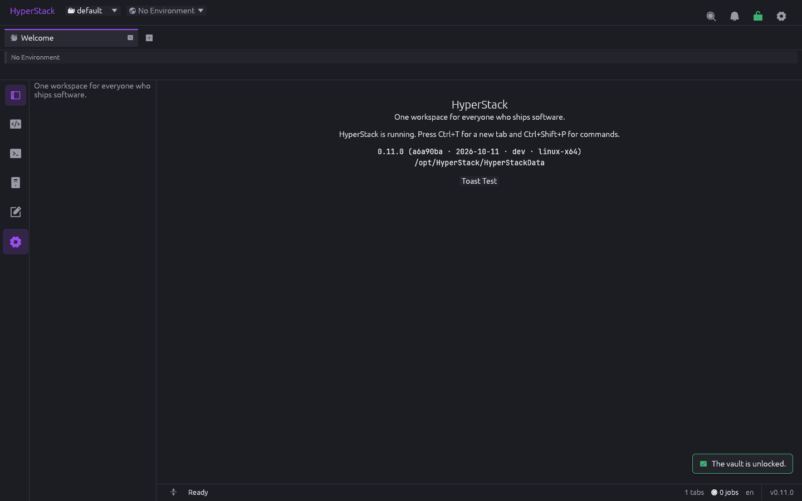
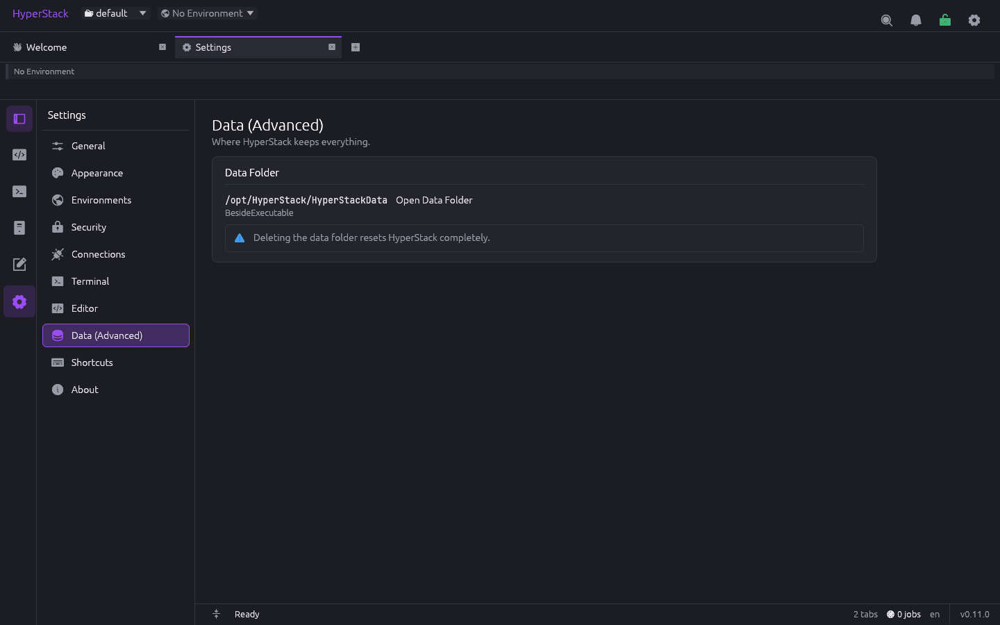

<p align="center"></p>

# HyperStack

**One workspace for everyone who ships software.**

<p align="center"></p>

HyperStack is a desktop application for full-stack developers, DevOps engineers,
database administrators, testers and integration engineers. It brings the tools
those people switch between all day — code editor, SQL database client, NoSQL
document-store client, Redis cache viewer, API client, SSH/SFTP, S3 browser,
Git, terminal, log tail viewer and a drawer of developer utilities — into a
single window organised as a **multi-row, multi-tab workspace**, where every tool
shares the same connection profiles, environments, secrets store, command palette
and theme.

> **Status:** Phase 0 (foundation) and M1 implemented, with M2 under way: the
> workspace shell with workspaces as projects (create, clone, switch, delete),
> portable data folder, vault, environments, settings (as a tab, with bundled
> and system fonts), a terminal with scrollback search and Ctrl+click links, a code editor with project tree and Markdown
> preview (with native Mermaid diagrams), an SSH + SFTP tool with a synced dual pane and port forwarding, an S3
> browser for AWS and S3-compatible stores, and the in-app updater
> with signed releases. Databases, API client, Git and logs follow in the
> next milestones per
> [docs/07-roadmap.md](docs/07-roadmap.md). Sibling project: `../eden-explorer`
> (Rust + egui file manager) serves as a **reference only**: HyperStack studies
> how it solved the multi-row tab strip, terminal, SSH/SFTP, S3 and Git status,
> then writes its own implementation. No code is copied or shared.

---

## Screenshots

Every feature that is built today, captured from a real `HyperStack` 0.11.0
build. See [docs/screenshots/](docs/screenshots/README.md) for how they were
made.

### Shell: launcher, command palette, tabs and splits

| | |
|---|---|
|  |  |
| **Welcome** — version, build and the portable data folder in use | **Launcher** (Ctrl+T) — tools by category plus pinned connections, filtered as you type |
|  |  |
| **Command palette** (Ctrl+Shift+P) — every action, fuzzy-matched, with its shortcut | **Multi-row tab strip** — tabs wrap onto more rows instead of scrolling |
|  |  |
| **Split panes** (Ctrl+\\) — here README preview beside the Scratchpad notes | **Bottom dock** (Ctrl+J) — Output, Jobs, Problems and Terminal |

### Workspaces and environments

| | |
|---|---|
|  |  |
| **Workspace switcher** in the title bar | **New workspace** — name, logo, and copy environments/connections from another |
|  |  |
| **Environment switcher** — colour-coded, protected ones marked | **Protected Production** — red banner and frame on every tab |
|  | |
| **Environments** — colour, inheritance, protected flag, variables (secrets go to the vault) | |

### Secret vault and connections

| | |
|---|---|
|  |  |
| **Create the vault** on first run (Argon2id + XChaCha20-Poly1305) | **Unlock** on start; the title-bar padlock locks it again |
|  |  |
| **Connection profile** (kind SSH) — host, user, start folder, auth | **Saved** — the password lives in the vault, the profile keeps a `secret:` reference |

### Code editor

| | |
|---|---|
|  |  |
| **Editor** — project tree with file icons, syntax highlighting, status bar (indent, encoding, EOL, language) | **Markdown preview** side by side (Ctrl+Shift+M) |
|  |  |
| **Find and replace** — case, whole word and regex, match count | **Mermaid flowcharts** drawn natively in the preview — subgraphs, shapes, wrapped wide ranks |
|  | |
| **Mermaid sequence diagrams** — participants, messages, notes, loop/alt blocks | |

### Terminal

| | |
|---|---|
|  |  |
| **Terminal** — shell profiles in the sidebar, colours, restart/clear, opened here from the editor with "Open Terminal Here" | **Search** (Ctrl+Shift+F) — plain or regex, match case, every hit highlighted, "n of m" |
|  | |
| **Links** — hold Ctrl to underline a URL or `path:line:col`; Ctrl+click opens it in the browser or the editor | |

### SSH and SFTP

| | |
|---|---|
|  |  |
| **Host key check** — new keys are shown by fingerprint before trusting | **Dual pane** — remote files (SFTP) on the left, the shell on the right |
|  |  |
| **Follow Shell Folder** — `cd` in the shell moves the file pane | **Edit remote files** — double-click downloads into the editor; saving uploads |
|  | |
| **Tunnels** — local port forwards (`ssh -L`) with live traffic; New Tunnel form in the sidebar | |

### S3 and S3-compatible storage

| | |
|---|---|
|  |  |
| **Browser** — profiles and buckets in the sidebar, breadcrumb, size / modified / class / ETag, Load More | **Profile** — provider presets (AWS, MinIO, R2, B2, Spaces, Wasabi), keys stored in the vault |
|  |  |
| **Import** profiles from `~/.aws/credentials` and `~/.aws/config` | **Presigned URLs** — GET or PUT, 15 minutes to 7 days |
|  |  |
| **Guarded delete** — prefixes and protected environments need the bucket name typed; shows versioning | **Edit objects** — double-click opens it in the editor; saving puts it back |

### Settings

| | |
|---|---|
|  |  |
| **General** — startup workspace, language, restore tabs | **Appearance** — colour scheme, interface font, zoom, tab sizing |
|  |  |
| **Security** — vault state, auto-lock, clipboard clearing | **Terminal** — default shell, scrollback, font, copy/paste behaviour |
|  |  |
| **Editor** — font, right-click copy/paste, reload, save hooks | **Shortcuts** — every action rebindable |
|  |  |
| **Data (Advanced)** — where the portable data folder lives | **About** — version, update channel and policy, Check Now, signing key |

## Why

A typical day for a backend developer touches VS Code, DBeaver, Postman, WinSCP,
PuTTY, Cyberduck, a Git GUI, Docker Desktop and three browser tabs of JWT /
JSON / cron utilities. Each tool keeps its own connection list, its own secrets,
its own idea of "staging vs production", its own theme and its own update
nagging. HyperStack's bet: **the connections, environments and secrets are the
product**, and the tools are views over them.

## Stack (decided)

| Layer | Choice | Why |
|---|---|---|
| Language | **Rust** (edition 2024) | Native speed, single portable binary, same ecosystem the author already knows from Eden Explorer |
| GUI | **egui / eframe 0.35** | Immediate-mode, proven by Eden Explorer for this kind of UI, fast tables and custom widgets, no web runtime |
| Async | **tokio** runtime on background threads, channels to the UI thread | Network tools (HTTP, SSH, DB drivers) are async-first |
| Distribution | **Portable by default on Windows**: one `HyperStack.exe`, all settings and data in a `HyperStackData/` folder beside it; no installer, no registry, no `%APPDATA%` | Run from a USB stick or a tools folder, move or back up by copying the folder |
| Storage | Human-readable TOML/JSON files for shareable things + SQLite for history/cache | Collections and profiles can live in git; history stays local |
| Secrets | Encrypted vault file beside the executable (master password, Argon2id + XChaCha20-Poly1305); OS keyring optional | Portable and never a plaintext password on disk |
| Platforms | Windows first-class, Linux and macOS supported from day one | DevOps and DBAs are often not on Windows |
| Delivery | Forgejo Actions on `git.zacx.net` plus a public GitHub mirror that shares the same history and version numbers: CI on every branch, automatic SemVer release on `main`, signed `manifest.json`; each copy updates itself from the forge it was downloaded from (Settings → Updates) and can revert once | Portable copies stay current without an installer, from either source |

Full reasoning in [docs/08-decisions.md](docs/08-decisions.md).

## Documents

| # | Document | What it covers |
|---|---|---|
| 01 | [Vision and scope](docs/01-vision-and-scope.md) | Problem, personas, principles, non-goals, success criteria |
| 02 | [Feature catalogue](docs/02-features.md) | Every feature, requested or suggested, with priority and effort |
| 03 | [Architecture](docs/03-architecture.md) | Crate layout, runtime model, the `Tool` trait, services, events, persistence |
| 04 | [UI design](docs/04-ui-design.md) | Window layout, multi-row tab space, splits, launcher, command palette, keyboard, theming |
| 05 | [Data model and storage](docs/05-data-model-and-storage.md) | Workspaces, connection profiles, environments and variables, file formats, history DB |
| 06 | [Security](docs/06-security.md) | Threat model, secrets, host keys, TLS, destructive-action guards |
| 07 | [Roadmap](docs/07-roadmap.md) | Phases, milestones, checklists, effort estimates |
| 08 | [Decisions (ADRs)](docs/08-decisions.md) | Why egui and not Tauri, why hybrid Git, why not sqlx, portable-first, and so on |
| 09 | [CI/CD, releases and in-app updates](docs/09-ci-cd-and-updates.md) | Forgejo workflows, automatic versioning, signed release manifest, Settings → Updates (check, download, verify, install, revert), the public GitHub mirror (§10) |
| — | [Workflows](.forgejo/workflows/) and [release scripts](scripts/) | Active Forgejo Actions (`ci.yml`, `release.yml`), their GitHub counterparts in [.github/workflows/](.github/workflows/) and the PowerShell scripts both run; [keys/](keys/) holds the release-signing public key |
| — | [Tool specs](docs/tools/) | One design document per tool (editor, SQL database, NoSQL, Redis, logs, API client, SSH/SFTP, S3, Git, terminal, containers, devtools) |

## Tool specs

| Tool | Spec | MVP? |
|---|---|---|
| Code editor | [tools/editor.md](docs/tools/editor.md) | Yes |
| Database client | [tools/database.md](docs/tools/database.md) | Yes |
| Redis cache viewer | [tools/redis.md](docs/tools/redis.md) | Yes |
| NoSQL / document DB client (MongoDB, CouchDB, Elasticsearch, DynamoDB, …) | [tools/nosql.md](docs/tools/nosql.md) | Yes (MongoDB, CouchDB) |
| Log tail viewer | [tools/logs.md](docs/tools/logs.md) | Yes (local + SSH sources) |
| API client (REST / WebSocket / GraphQL / gRPC) | [tools/api-client.md](docs/tools/api-client.md) | Yes (REST) |
| SSH + SFTP | [tools/ssh-sftp.md](docs/tools/ssh-sftp.md) | Yes |
| S3 browser | [tools/s3.md](docs/tools/s3.md) | Yes |
| Git | [tools/git.md](docs/tools/git.md) | Yes |
| Terminal | [tools/terminal.md](docs/tools/terminal.md) | Yes |
| Containers (Docker / Podman / Kubernetes) | [tools/containers.md](docs/tools/containers.md) | Phase 2 |
| Devtools drawer (JSON, JWT, regex, cron, diff, …) | [tools/devtools.md](docs/tools/devtools.md) | Partly |

## Build and run

```bash
cargo build --release -p hyperstack          # target/release/HyperStack.exe (static MSVC build)
./target/release/HyperStack.exe --version
./target/release/HyperStack.exe --self-test --data-dir ./tmp-data
./target/release/HyperStack.exe --data-dir ./tmp-data   # run against a scratch data folder
cargo clippy --workspace --all-targets --locked -- -D warnings && cargo test --workspace --locked
HS_S3_ENDPOINT=http://127.0.0.1:5055 cargo test -p hs-core --test s3_live   # S3 client against moto_server or MinIO
```

On Linux, `cargo clippy --workspace` also needs `libwayland-dev`,
`libxkbcommon-dev` and `pkg-config` (the UI test harness builds the Wayland
backend).

## Repository layout

```
hyper-stack/
├── Cargo.toml                 # workspace
├── crates/
│   ├── hyperstack/            # the binary: eframe shell, tab space, launcher, settings
│   ├── hs-core/               # services: workspace model, jobs, events, settings, secrets, env vars
│   ├── hs-ui/                 # shared widgets: tab strip, data table, tree, split panes, palette, theme
│   ├── hs-editor/             # text buffer + highlighting + editor widget (used by several tools)
│   ├── hs-term/               # terminal grid, PTY, SSH shell transport
│   └── tools/
│       ├── tool-editor/
│       ├── tool-db/           # SQL: + drivers/ (postgres, mysql, sqlite, mssql, …)
│       ├── tool-nosql/        # documents: + drivers/ (mongodb, couchdb, elasticsearch, dynamodb, …)
│       ├── tool-redis/
│       ├── tool-logs/
│       ├── tool-api/
│       ├── tool-ssh/
│       ├── tool-s3/
│       ├── tool-git/
│       ├── tool-terminal/
│       ├── tool-containers/
│       └── tool-devtools/
├── assets/
│   └── icon/                  # hyperstack.png (512 master), hyperstack.ico, PNG sizes — regenerate with scripts/make-icons.ps1
├── locales/                   # Fluent .ftl files
└── docs/
```

## Portable layout on disk (Windows)

```
HyperStack\
├── HyperStack.exe
├── HyperStackData\            # everything the app writes; delete it for a factory reset
│   ├── settings.toml
│   ├── vault.hsv              # encrypted secrets
│   ├── history.sqlite
│   ├── workspaces\default\    # built-in workspace (connections, environments, collections …)
│   └── themes\  shortcuts.toml  known_hosts  cache\  logs\
└── (optional) README.txt
```

See [docs/05-data-model-and-storage.md](docs/05-data-model-and-storage.md) for
the full layout and the rules for non-writable locations.

## License

To be decided — MIT suggested.
