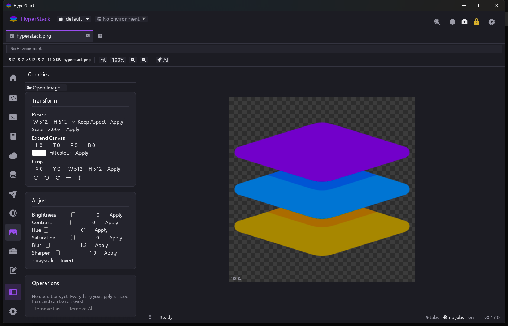
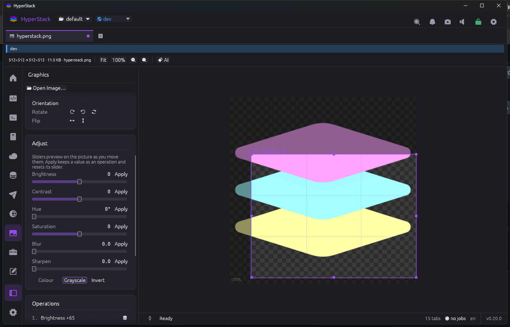

<p align="center"></p>

# HyperStack

**One workspace for everyone who ships software.**

<p align="center">
  <a href="https://github.com/mzaki-raup/hyper-stack/releases"></a>
  <a href="https://github.com/mzaki-raup/hyper-stack/releases/latest"></a>
  <a href="LICENSE"></a>
  <a href="https://github.com/mzaki-raup/hyper-stack/actions/workflows/ci.yml"></a>
  <a href="https://github.com/mzaki-raup/hyper-stack/stargazers"></a>
</p>

<p align="center"></p>

HyperStack is a desktop application for full-stack developers, DevOps engineers,
database administrators, testers and integration engineers. It brings the tools
those people switch between all day — code editor, SQL database client, NoSQL
document-store client, Redis cache viewer, API client, SSH/SFTP, S3 browser,
Git, terminal, log tail viewer and a drawer of developer utilities — into a
single window organised as a **multi-row, multi-tab workspace**, where every tool
shares the same connection profiles, environments, secrets store, command palette
and theme.

> **Status:** Phase 0 (foundation), M1 and M2 implemented, M3 under way and
> the first parts of M4 and M5 landed (2026-10-15): the workspace shell with
> workspaces as projects (create with a logo, clone, rename, switch, delete),
> a pinned **Home** dashboard and a pinned Settings tab in every workspace,
> portable data folder, vault, environments, theme modes (System / Dark /
> Light with a scheme for each), accessibility (Read Aloud), settings
> import/export, a terminal with scrollback search and Ctrl+click links, a
> code editor holding several projects (each with its own row of file tabs,
> the file's full path under them, Run with F5, Git status, diffs and
> history) and Markdown preview with native Mermaid diagrams, an SSH + SFTP
> tool with a synced dual pane, port forwarding and a file pane that copies
> files and folders to and from the system clipboard, an S3 browser for AWS
> and S3-compatible stores, a SQL client for PostgreSQL, MySQL/MariaDB and
> SQLite with a cell viewer that previews pictures and documents, a **Redis**
> key browser with type-aware viewers, a console and guards, a **NoSQL**
> client for MongoDB and CouchDB, an **API
> client** with collections, JavaScript scripts (`pm` API) and Postman
> import/export, **Devtools** (Base64, URL encoding, hashes, JWT, Firebase
> tokens, Jasypt, PKI messages; one tab per utility, inputs persisted, secrets
> saved to the environment vault and used as `{{variables}}`), a **Graphics** tool (convert, resize, extend,
> adjust, icons), an embedded **Browser** (WebView2, ad and script
> blocking, forced dark, inspect, print), **Snip** and **Print…** for every
> tab, an optional AI assistant in the editor (Anthropic, Gemini, Azure
> OpenAI, AWS Bedrock, 1min.AI, LM Studio, Ollama or any OpenAI-compatible
> service) and a review-only assistant in
> Terminal, SSH, SQL, S3, API client and Graphics whose code blocks can be
> inserted but never run, and the in-app updater with signed releases.
> The Git write side and logs follow in the next milestones
> per [docs/07-roadmap.md](docs/07-roadmap.md). Sibling project:
> `../eden-explorer` (Rust + egui file manager) serves as a **reference
> only**: HyperStack studies how it solved the multi-row tab strip,
> terminal, SSH/SFTP, S3 and Git status, then writes its own
> implementation. No code is copied or shared.

---

## Screenshots

Every feature that is built today, captured from a real `HyperStack`
build. See [docs/screenshots/](docs/screenshots/README.md) for how they were
made.

### Shell: launcher, command palette, tabs and splits

| | |
|---|---|
|  |  |
| **Home** — the pinned first tab of every workspace: Get Started cards, workspaces, tools, recent tabs, pinned connections, keys | **Launcher** (Ctrl+T) — tools by category plus pinned connections, filtered as you type |
|  |  |
| **Command palette** (Ctrl+Shift+P) — every action, fuzzy-matched, with its shortcut | **Multi-row tab strip** — tabs wrap onto more rows instead of scrolling |
|  |  |
| **Split panes** (Ctrl+\\) — here README preview beside the Scratchpad notes | **Bottom dock** (Ctrl+J) — Output, Jobs, Problems and Terminal |

### Workspaces and environments

| | |
|---|---|
|  |  |
| **Workspace switcher** in the title bar, with the selected workspace logo | **New workspace** — name, logo, and copy environments/connections from another |
|  |  |
| **Environment switcher** — colour-coded, protected ones marked | **Protected Production** — red banner and frame on every tab |
|  | |
| **Environments** — colour, inheritance, protected flag, variables (secrets go to the vault) | |

Settings is always open as a pinned tab in each workspace. Settings → Workspace
lets you rename a non-default workspace and set or remove its logo after
creation. The title-bar notification bell opens recent notifications; Quick
Open opens the searchable tools, connections and project items palette.

### Secret vault and connections

| | |
|---|---|
|  |  |
| **Create the vault** on first run (Argon2id + XChaCha20-Poly1305) | **Unlock** on start; the title-bar padlock locks it again |
|  |  |
| **Connection profile** (kind SSH) — host, user, start folder, auth | **Saved** — the password lives in the vault, the profile keeps a `secret:` reference |

### Code editor

| | |
|---|---|
|  |  |
| **Editor** — project tree with file icons, syntax highlighting, status bar (indent, encoding, EOL, language); with a language server installed (rust-analyzer, typescript-language-server, pyright, gopls, clangd, …): completion as you type, hover, diagnostics and a Problems panel, go to definition (F12), references, rename (F2) and formatting; with a debug adapter installed (CodeLLDB, lldb-dap, debugpy, delve, netcoredbg): breakpoints, stepping, variables, call stack and a console | **Markdown preview** side by side (Ctrl+Shift+M) |
| **Encoding** — choose UTF-8/UTF-8 BOM, UTF-16 LE/BE with or without BOM, or Windows-1252 per file; reopen a clean file from disk to decode with a different encoding. | |
|  |  |
| **Find and replace** — case, whole word and regex, match count | **Mermaid flowcharts** drawn natively in the preview — subgraphs, shapes, wrapped wide ranks |
|  |  |
| **Projects as tabs** — each project root has one window tab; opening the same root again focuses it. Inside it, files are a second strip of tabs; both strips wrap onto more rows instead of hiding tabs. File-tab minimum width is configurable in Settings → Appearance. Files from outside the projects (a terminal Ctrl+click) collect in an **Other Files** tab. Ctrl+F4 closes a file, Ctrl+Alt+PgUp/PgDn walks the file tabs. | **Model picker** — the models the provider lists (LM Studio: every downloaded model; 1min.AI: a built-in list), or type any other id |
|  |  |
| **Mermaid sequence diagrams** — participants, messages, notes, loop/alt blocks | **AI Assistant** (Ctrl+Shift+I) — chat about the file or the selection; Explain, Review, Improve, Add Comments; proposed changes as diffs with Apply / Reject |
|  |  |
| **Language server features** — completion as you type with documentation, hover, go to definition, references, rename and format through any installed LSP server (Settings → Editor → Language Servers shows which are found) | **Problems panel** (Ctrl+Shift+J) — diagnostics as underlines in the text, listed with file and line; the status bar counts errors and warnings |
|  |  |
| **Debugger** — breakpoints in the gutter (F9), the stopped line with an arrow, Continue/Step controls (F5, F10, F11), and the Variables tab of the debug panel; adapters (CodeLLDB, lldb-dap, debugpy, delve, netcoredbg) are installed by you, configurations come from `.hyperstack/debug.json`, `.vscode/launch.json` or are generated | **Call Stack** — frames of the paused thread; clicking one shows its variables and line |
|  |  |
| **Git in the editor** — the branch on the project, change letters and colours in the tree, change markers in the gutter as you type | **Source Control** (Ctrl+Shift+G) — staged, changed and untracked files; diffs inline or side by side; Up/Down steps through them |
|  | |
| **History** (Ctrl+Shift+H) — commits with branch and tag chips; each commit's message, files and diffs | |
|  |  |
| **Cascade** — the assistant applies its changes (one undo step each) and keeps going on the updated file until it answers DONE | **AI providers** — Anthropic, Google Gemini, Azure OpenAI, AWS Bedrock, 1min.AI, or any OpenAI-compatible server (OpenAI, Mistral, Kimi, Hunyuan, OpenRouter, local LM Studio or Ollama with every downloaded model). Add one from a gallery of fifteen services; keys in the vault |

### Terminal

| | |
|---|---|
|  |  |
|  | |
| **Terminal** — shell profiles in the sidebar, colours, restart/clear, opened here from the editor with "Open Terminal Here" | **Search** (Ctrl+Shift+F) — plain or regex, match case, every hit highlighted, "n of m" |
|  | |
| **Links** — hold Ctrl to underline a URL or `path:line:col`; Ctrl+click opens it in the browser or the editor | |

### SSH and SFTP

| | |
|---|---|
|  |  |
| **Host key check** — new keys are shown by fingerprint before trusting | **Dual pane** — remote files (SFTP) on the left, the shell on the right |
|  |  |
| **Follow Shell Folder** — `cd` in the shell moves the file pane | **Edit remote files** — double-click downloads into the editor; saving uploads |
|  | |
| **Tunnels** — local port forwards (`ssh -L`) with live traffic; New Tunnel form in the sidebar | |

**Clipboard** — **Copy** on a remote entry puts it on the system clipboard
(a folder with everything inside it), ready to paste into the file manager;
the pane's paste button uploads whatever the clipboard holds into the folder
on screen. Windows only.

### S3 and S3-compatible storage

| | |
|---|---|
|  |  |
| **Browser** — profiles and buckets in the sidebar, breadcrumb, size / modified / class / ETag, Load More | **Profile** — provider presets (AWS, MinIO, R2, B2, Spaces, Wasabi), keys stored in the vault |
|  |  |
| **Import** profiles from `~/.aws/credentials` and `~/.aws/config` | **Presigned URLs** — GET or PUT, 15 minutes to 7 days |
|  |  |
| **Guarded delete** — prefixes and protected environments need the bucket name typed; shows versioning | **Edit objects** — double-click opens it in the editor; saving puts it back |

### SQL databases (PostgreSQL, MySQL / MariaDB, SQLite)

<p align="center"></p>

| | |
|---|---|
|  |  |
| **Schema browser** — schemas, tables, views, functions, columns with PK/FK/NOT NULL, indexes; double-click a table for its rows | **Completion** from the schema cache — tables after FROM/JOIN, columns after an alias |
|  |  |
| **Result grid** — streamed rows, NULL shown as NULL, numbers right-aligned, sort, filter, Copy As, Export | **Scripts** — one result tab per statement; the failing one is selected and the server's error position underlined |
|  |  |
| **Protected environments** open read-only — writes are refused until **Allow Writes** | **Guards** — UPDATE/DELETE without WHERE, DROP, TRUNCATE ask first; on production the table name must be typed |
|  |  |
| **Transactions** — Auto-Commit or Manual Commit with Commit / Rollback and an open-transaction badge | **Cell viewer** — JSON pretty-printed, binary as a hex dump |
|  | |
| **Connection** — paste a `postgres://` / `mysql://` / `sqlite:` URL; the password goes into the vault; TLS modes and an SSH tunnel through any SSH profile | |

### API client

| | |
|---|---|
|  |  |
| **Requests** — method, URL with `{{variables}}`, params, headers, body (JSON, text, XML, form, multipart, binary), auth (inherit, basic, bearer, API key); response as pretty, raw or preview with headers, cookies, tests and console; Copy as curl, Import curl; history | **Scripts** — pre-request and post-response JavaScript with the `pm` API (`pm.environment`, `pm.globals`, `pm.collectionVariables`, `pm.request`, `pm.response`, `pm.test`, `pm.expect`, `console`), snippets, collection libraries; Postman v2.1 collections and environments import and export |

|  | |
| **Assistant that fills the client** — ask for a collection, a request, headers, a body, auth, scripts or docs; the answer's `hs-api` block gets **Apply**, which edits the open request and the collections exactly as the sidebar would. Nothing is sent until you press Send. | |

Collections are JSON files in the workspace; variables resolve through the
collection, the active environment (vault secrets only when sending) and
globals. A non-GET request to a protected environment asks first.

### Devtools

| | |
|---|---|
|  |  |
| **JWT** — decode with claim explanations and expiry, verify with a secret or public key, sign for testing (HS256/384/512, RS256/384/512, ES256); the secret can be saved to the environment (vault) and the `{{reference}}` peeked | **Hashes** — MD5, SHA-1/2/3, BLAKE3, CRC32 of text or a file, HMAC, hex or Base64, compare field |
|  |  |
| **Jasypt** — `PBEWithMD5AndDES` and `PBEWITHHMACSHA512ANDAES_256` property encryption with jasypt's salt/IV layout and `ENC(…)`, plus the legacy DES/AES/MD5 DataEncryptor | **PKI messages** — sign with RSA and encrypt with AES-256-GCM under a shared key derived from a device id, then decrypt and verify, for both request and response flows |

Also **Base64** (auto-detect, picture/text/document preview, data URI,
Basic auth header), **URL** (percent-encode and decode a component, a whole
URL or form data, with a table of the URL's parts) and **Firebase tokens**
(custom, access and ID tokens from a service account). Keys typed into a
utility are never saved.

### Graphics

| | |
|---|---|
|  |  |
|  | |
| **Crop placeholder** — Select on Canvas shows a rectangle with grips; move it, resize it by an edge or corner, or draw a new one, and the X/Y/W/H boxes follow | |
| **Pictures** open from the editor's project tree or a dialog; zoom on a checkerboard; convert between PNG, JPEG, WebP, BMP, GIF and ICO; multi-size ICO export; icon frame extraction | **Operations** — resize, scale, extend canvas, crop, rotate, flip, brightness, contrast, hue, saturation, grayscale, invert, blur, sharpen, each removable; review-only AI assistant |

### Scratchpad

| | |
|---|---|
|  | |
| **Dictate to any assistant** — the microphone beside Send runs the operating system's own speech recognition (offline); phrases are typed into the box, a stop keeps the phrase in flight, the session ends on its own after a set time, and nothing is sent until you press Send | |
|  |  |
| **Notes** — a collection of Markdown notes per workspace: the sidebar lists them newest first with pinned notes on top, one tab per note, source and preview side by side, saved 1.5 s after typing stops | **Assistant** — drafts checklists, tables, Mermaid diagrams and command fences; each block inserts at the cursor |

### Browser

| | |
|---|---|
|  | |
| **Browser** — WebView2 pages in multi-row tabs: address bar with search fallback, back/forward/reload/home, per-page ad and tracker blocking, JavaScript switch, forced dark rendering, zoom, Inspect, Print; pages restored per workspace; Shift+click a terminal link to open it here (Windows) | |

### Settings

| | |
|---|---|
|  |  |
| **General** — startup workspace, restore tabs, language; export and import settings and shortcuts behind the master password | **Appearance** — System / Dark / Light mode with a scheme for each (clickable swatches), interface font and size, UI zoom, tab widths, activity rail order and labels |
|  |  |
| **Accessibility** — Read Aloud through the OS voice (a title-bar button lists what the active tab can read), speech rate, reduce motion | **Workspace** — rename, logo, folder, compare environments with another workspace and copy the missing ones |
|  |  |
| **Security** — vault status, relock timer, clipboard clearing, change the master password | **Shortcuts** — every action rebindable; conflicts listed |
|  |  |
| **Terminal** — default shell, font, right-click copy/paste, link detection | **Editor** — font, right-click, trim and final newline on save, auto reload |
|  | |
| **About** — version, update channel, Check Now, release notes, data folder | |

Every tab can be **snipped** to a PNG (Ctrl+Alt+S, camera menu) or
**printed** (Ctrl+Alt+P) as an HTML page with a Light/Dark switch that
opens in your browser: code with its highlighting, the Markdown preview,
a query with its result table, a console screen, an S3 listing, a request
with its response, a picture.

## Why

A typical day for a backend developer touches VS Code, DBeaver, Postman, WinSCP,
PuTTY, Cyberduck, a Git GUI, Docker Desktop and three browser tabs of JWT /
JSON / cron utilities. Each tool keeps its own connection list, its own secrets,
its own idea of "staging vs production", its own theme and its own update
nagging. HyperStack's bet: **the connections, environments and secrets are the
product**, and the tools are views over them.

## Stack (decided)

| Layer | Choice | Why |
|---|---|---|
| Language | **Rust** (edition 2024) | Native speed, single portable binary, same ecosystem the author already knows from Eden Explorer |
| GUI | **egui / eframe 0.35** | Immediate-mode, proven by Eden Explorer for this kind of UI, fast tables and custom widgets, no web runtime |
| Async | **tokio** runtime on background threads, channels to the UI thread | Network tools (HTTP, SSH, DB drivers) are async-first |
| Distribution | **Portable by default on Windows**: one `HyperStack.exe`, all settings and data in a `HyperStackData/` folder beside it; no installer, no registry, no `%APPDATA%` | Run from a USB stick or a tools folder, move or back up by copying the folder |
| Storage | Human-readable TOML/JSON files for shareable things + SQLite for history/cache | Collections and profiles can live in git; history stays local |
| Secrets | Encrypted vault file beside the executable (master password, Argon2id + XChaCha20-Poly1305); OS keyring optional | Portable and never a plaintext password on disk |
| Platforms | Windows first-class, Linux and macOS supported from day one | DevOps and DBAs are often not on Windows |
| Delivery | Forgejo Actions on `git.zacx.net` plus a public GitHub mirror that shares the same history and version numbers: CI on every branch, automatic SemVer release on `main`, signed `manifest.json`; each copy updates itself from the forge it was downloaded from (Settings → Updates) and can revert once | Portable copies stay current without an installer, from either source |

Full reasoning in [docs/08-decisions.md](docs/08-decisions.md).

## Documents

| # | Document | What it covers |
|---|---|---|
| 01 | [Vision and scope](docs/01-vision-and-scope.md) | Problem, personas, principles, non-goals, success criteria |
| 02 | [Feature catalogue](docs/02-features.md) | Every feature, requested or suggested, with priority and effort |
| 03 | [Architecture](docs/03-architecture.md) | Crate layout, runtime model, the `Tool` trait, services, events, persistence |
| 04 | [UI design](docs/04-ui-design.md) | Window layout, multi-row tab space, splits, launcher, command palette, keyboard, theming |
| 05 | [Data model and storage](docs/05-data-model-and-storage.md) | Workspaces, connection profiles, environments and variables, file formats, history DB |
| 06 | [Security](docs/06-security.md) | Threat model, secrets, host keys, TLS, destructive-action guards |
| 07 | [Roadmap](docs/07-roadmap.md) | Phases, milestones, checklists, effort estimates |
| 08 | [Decisions (ADRs)](docs/08-decisions.md) | Why egui and not Tauri, why hybrid Git, why not sqlx, portable-first, and so on |
| 09 | [CI/CD, releases and in-app updates](docs/09-ci-cd-and-updates.md) | Forgejo workflows, automatic versioning, signed release manifest, Settings → Updates (check, download, verify, install, revert), the public GitHub mirror (§10) |
| — | [Workflows](.forgejo/workflows/) and [release scripts](scripts/) | Active Forgejo Actions (`ci.yml`, `release.yml`), their GitHub counterparts in [.github/workflows/](.github/workflows/) and the PowerShell scripts both run; [keys/](keys/) holds the release-signing public key |
| — | [Tool specs](docs/tools/) | One design document per tool (editor, SQL database, NoSQL, Redis, logs, API client, SSH/SFTP, S3, Git, terminal, containers, devtools) |

## Tool specs

| Tool | Spec | MVP? |
|---|---|---|
| Code editor | [tools/editor.md](docs/tools/editor.md) | Yes |
| Database client | [tools/database.md](docs/tools/database.md) | Yes |
| Redis cache viewer | [tools/redis.md](docs/tools/redis.md) | Yes |
| NoSQL / document DB client (MongoDB, CouchDB, Elasticsearch, DynamoDB, …) | [tools/nosql.md](docs/tools/nosql.md) | Yes (MongoDB, CouchDB) |
| Log tail viewer | [tools/logs.md](docs/tools/logs.md) | Yes (local + SSH sources) |
| API client (REST / WebSocket / GraphQL / gRPC) | [tools/api-client.md](docs/tools/api-client.md) | Yes (REST) |
| SSH + SFTP | [tools/ssh-sftp.md](docs/tools/ssh-sftp.md) | Yes |
| S3 browser | [tools/s3.md](docs/tools/s3.md) | Yes |
| Git | [tools/git.md](docs/tools/git.md) | Yes |
| Terminal | [tools/terminal.md](docs/tools/terminal.md) | Yes |
| Containers (Docker / Podman / Kubernetes) | [tools/containers.md](docs/tools/containers.md) | Phase 2 |
| Devtools drawer (JSON, JWT, regex, cron, diff, …) | [tools/devtools.md](docs/tools/devtools.md) | Partly |
| [docs/tools/graphics.md](docs/tools/graphics.md) | Graphics: pictures, operations, formats, icons, crop placeholder |
| [docs/tools/scratchpad.md](docs/tools/scratchpad.md) | Scratchpad: Markdown notes per workspace, pinning, dual pane, AI assistant |
| [docs/tools/browser.md](docs/tools/browser.md) | Browser: WebView2 pages, blocking, dark mode, devtools |

## Build and run

```bash
cargo build --release -p hyperstack          # target/release/HyperStack.exe (static MSVC build)
./target/release/HyperStack.exe --version
./target/release/HyperStack.exe --self-test --data-dir ./tmp-data
./target/release/HyperStack.exe --data-dir ./tmp-data   # run against a scratch data folder
cargo clippy --workspace --all-targets --locked -- -D warnings && cargo test --workspace --locked
HS_S3_ENDPOINT=http://127.0.0.1:5055 cargo test -p hs-core --test s3_live   # S3 client against moto_server or MinIO
# SQL drivers: SQLite always; PostgreSQL / MySQL when given host:port:user:password:database
HS_PG=127.0.0.1:5432:postgres:pg:postgres HS_MYSQL=127.0.0.1:3306:dev:dev:shop cargo test -p tool-db --test drivers
```

On Linux, `cargo clippy --workspace` also needs `libwayland-dev`,
`libxkbcommon-dev` and `pkg-config` (the UI test harness builds the Wayland
backend).

## Repository layout

```
hyper-stack/
├── Cargo.toml                 # workspace
├── crates/
│   ├── hyperstack/            # the binary: eframe shell, tab space, launcher, settings
│   ├── hs-core/               # services: workspace model, jobs, events, settings, secrets, env vars
│   ├── hs-ui/                 # shared widgets: tab strip, data table, tree, split panes, palette, theme
│   ├── hs-editor/             # text buffer + highlighting + editor widget (used by several tools)
│   ├── hs-term/               # terminal grid, PTY, SSH shell transport
│   └── tools/
│       ├── tool-editor/
│       ├── tool-db/           # SQL: driver/ (postgres, mysql, sqlite; mssql, … later), splitter + classifier, grid
│       ├── tool-nosql/        # documents: + drivers/ (mongodb, couchdb, elasticsearch, dynamodb, …)
│       ├── tool-redis/
│       ├── tool-logs/
│       ├── tool-api/
│       ├── tool-ssh/
│       ├── tool-s3/
│       ├── tool-git/
│       ├── tool-terminal/
│       ├── tool-containers/
│       └── tool-devtools/
├── assets/
│   └── icon/                  # hyperstack.png (512 master), hyperstack.ico, PNG sizes — regenerate with scripts/make-icons.ps1
├── locales/                   # Fluent .ftl files
└── docs/
```

## Portable layout on disk (Windows)

```
HyperStack\
├── HyperStack.exe
├── HyperStackData\            # everything the app writes; delete it for a factory reset
│   ├── settings.toml
│   ├── vault.hsv              # encrypted secrets
│   ├── history.sqlite
│   ├── workspaces\default\    # built-in workspace (connections, environments, collections …)
│   └── themes\  shortcuts.toml  known_hosts  cache\  logs\
└── (optional) README.txt
```

See [docs/05-data-model-and-storage.md](docs/05-data-model-and-storage.md) for
the full layout and the rules for non-writable locations.

## License

To be decided — MIT suggested.
