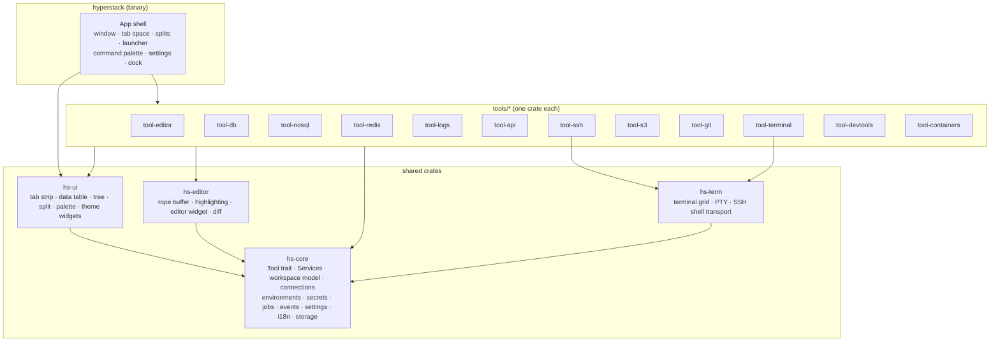
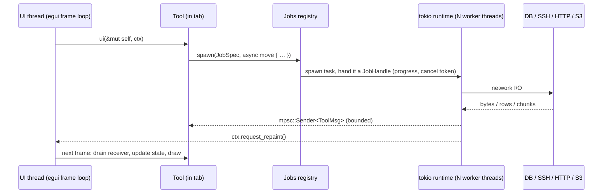

# 03 — Architecture

**Status:** draft · **Last updated:** 2026-10-10

## 1. Overview

HyperStack is a single Rust binary built on **eframe/egui**. The UI runs on the
main thread in immediate mode; all I/O runs on a **tokio** runtime in background
threads and talks to the UI through channels. Each tool (editor, database, API
client, …) is a separate crate implementing one `Tool` trait and is hosted in a
tab by the shell. Shared concerns — connections, environments, secrets, jobs,
events, settings, theme — live in `hs-core` and `hs-ui` and are handed to every
tool through a `Services` handle.



## 2. Crate layout

```
hyper-stack/
├── Cargo.toml                      # [workspace], shared [workspace.dependencies]
├── crates/
│   ├── hyperstack/                 # bin. eframe App, main window, tab space, launcher,
│   │                               # settings UI, dock, palette wiring, tool registry
│   ├── hs-core/                    # no egui dependency except for small shared types
│   │   ├── tool.rs                 # Tool trait, ToolDescriptor, ToolContext
│   │   ├── services.rs             # Services handle (Arc of everything below)
│   │   ├── workspace/              # Workspace, TabModel, layout tree, persistence
│   │   ├── connections/            # ConnectionProfile, kinds, folders, import
│   │   ├── environments/           # Environment, variables, substitution engine
│   │   ├── secrets/                # SecretStore trait + encrypted vault (default) + OS keyring (opt-in) impls
│   │   ├── jobs/                   # JobHandle, progress, cancel, Jobs registry
│   │   ├── events/                 # EventBus (broadcast) + typed events
│   │   ├── settings/               # Settings, schema, migration
│   │   ├── storage/                # paths, TOML/JSON io, SQLite history db
│   │   ├── i18n/                   # Fluent loader
│   │   ├── update/                 # version info, release check, manifest + signature verify,
│   │   │                           # download job, rename-and-relaunch install, revert
│   │   └── runtime.rs              # tokio runtime bootstrap, UI wake-up handle
│   ├── hs-ui/                      # egui widgets with no tool knowledge
│   │   ├── tabs.rs                 # multi-row tab strip (ported compute_tab_layout)
│   │   ├── table.rs                # virtualised data grid (sort, filter, resize, copy)
│   │   ├── tree.rs                 # lazy tree (project, schema, hosts, buckets)
│   │   ├── split.rs                # split layout tree with drag handles
│   │   ├── palette.rs              # command palette / quick-open
│   │   ├── theme.rs                # palette, prebuilt themes, live preview
│   │   ├── toast.rs, dialog.rs, badge.rs, env_banner.rs, icons.rs
│   ├── hs-editor/                  # ropey buffer, syntect highlighting, editor widget, diff
│   ├── hs-term/                    # alacritty_terminal grid, portable-pty, russh shell
│   └── tools/
│       ├── tool-editor/
│       ├── tool-db/                # SQL: + src/drivers/{sqlite,postgres,mysql,mssql,clickhouse,duckdb,odbc}.rs
│       ├── tool-nosql/             # documents: + src/drivers/{mongodb,couchdb,elasticsearch,dynamodb,cassandra}.rs
│       ├── tool-redis/             # key browser, type viewers, console, pub/sub, server info
│       ├── tool-logs/              # log tail viewer: sources, index, filters, parsers
│       ├── tool-api/
│       ├── tool-ssh/
│       ├── tool-s3/
│       ├── tool-git/
│       ├── tool-terminal/
│       ├── tool-devtools/
│       └── tool-containers/
├── assets/                         # icons (Phosphor), fonts (incl. a Nerd Font for the terminal), default themes
├── locales/                        # en.ftl, …
├── docs/
├── scripts/                        # release tooling (PowerShell): next-release, update-version,
│                                   # build-and-package, verify-release (see docs/09)
├── keys/                           # minisign.pub: release-signing public key (also embedded in the app)
├── .forgejo/workflows/             # ci.yml, release.yml (active; no-op until Cargo.toml exists)
└── CHANGELOG.md                    # prepended by the release workflow
```

Rules:

- `hs-core` must not depend on any tool crate. Tools depend on `hs-core`,
  `hs-ui`, optionally `hs-editor` and `hs-term`. Tools never depend on each
  other; cross-tool features go through `Services` and events.
- Heavy optional drivers (`mongodb`, `tiberius`, `kube`) are Cargo features on
  their tool crate so a minimal build stays small.
- Platform code (`windows`, `security-framework`, `secret-service`) is confined
  to `hs-core::secrets`, `hs-core::storage::paths` and `hs-term::pty`.

## 3. Runtime model



- **One tokio multi-thread runtime** owned by `hs-core::runtime`, started before
  the window. Blocking drivers (rusqlite, some ODBC) run under
  `spawn_blocking`.
- **Tools never hold a lock across a frame.** Each tool owns its state; results
  arrive as messages drained at the start of `ui()`.
- **Repaint on demand.** Background tasks call `request_repaint()` through an
  `UiWaker` handle; the app does not spin.
- **Jobs** wrap any task longer than ~200 ms: id, title, tool, environment,
  progress (`Indeterminate | Fraction | Bytes{done,total}`), log lines, cancel
  token. The dock's Jobs panel lists them; toasts summarise completion.
- **Back-pressure.** Channels are bounded; streaming result sets and terminal
  output use chunked messages, and the sender awaits capacity.

## 4. The `Tool` trait

```rust
// hs-core/src/tool.rs (sketch)

pub struct ToolDescriptor {
    pub id: &'static str,          // "editor", "db", "api", "ssh", "sftp", "s3", "git", "terminal", "devtools.json"
    pub title_key: &'static str,   // Fluent key
    pub icon: &'static str,        // Phosphor glyph
    pub category: ToolCategory,    // Code, Data, Network, Infra, Utilities
    pub accepts: &'static [Accept],// what can be dropped/opened in it: LocalFile, RemoteFile, Connection(kind), Text
}

pub trait Tool: Send {
    fn descriptor(&self) -> &ToolDescriptor;

    /// Tab label, may change (file name, "query #3 — staging", host name).
    fn title(&self) -> Cow<'_, str>;
    fn dirty(&self) -> bool { false }          // shows the unsaved dot; blocks close
    fn environment(&self) -> Option<EnvId>;    // drives the env banner colour

    /// Main area. Called every frame the tab is visible.
    fn ui(&mut self, ui: &mut egui::Ui, cx: &mut ToolContext);
    /// Optional left sidebar content (project tree, schema, collections).
    fn sidebar(&mut self, ui: &mut egui::Ui, cx: &mut ToolContext) {}
    /// Optional toolbar row under the tab strip.
    fn toolbar(&mut self, ui: &mut egui::Ui, cx: &mut ToolContext) {}

    /// Commands exposed to the palette and shortcuts while this tab is active.
    fn commands(&self) -> Vec<CommandDescriptor>;
    fn run_command(&mut self, id: &str, cx: &mut ToolContext) -> bool;

    /// Persistence for workspace restore. Must not include secrets.
    fn save_state(&self) -> serde_json::Value;
    fn on_close(&mut self) -> CloseDecision { CloseDecision::Close }

    /// Cross-tool: something was dropped or "opened with" this tool.
    fn open(&mut self, item: OpenRequest, cx: &mut ToolContext) -> bool { false }
    /// Typed events from the bus the tool subscribed to.
    fn on_event(&mut self, ev: &Event, cx: &mut ToolContext) {}
}

pub trait ToolFactory: Send + Sync {
    fn descriptor(&self) -> &ToolDescriptor;
    fn create(&self, services: Services, restore: Option<serde_json::Value>) -> Box<dyn Tool>;
}
```

`ToolContext` gives a tool, per frame: `services: &Services`, the current
`EnvId`, a `ui_waker`, the `theme`, and an `actions` queue for requests that
the shell must execute (open a new tab with another tool, focus a tab, show a
dialog, start a job, set status text).

The shell keeps a **tool registry** (`Vec<Box<dyn ToolFactory>>`) populated at
startup. A tab is `TabModel { id, factory_id, tool: Box<dyn Tool>, pinned,
colour, group }`.

## 5. Services (shared state)

| Service | Responsibility | Backing |
|---|---|---|
| `Connections` | CRUD for `ConnectionProfile` of every kind, folders, tags, colour, import | TOML files in workspace |
| `Environments` | Named variable sets, active environment, `{{var}}` substitution with scopes (global → workspace → environment → collection → request) | TOML files |
| `Secrets` | `get/set/delete(SecretRef)`; never returns to UI unless user clicks "reveal" | encrypted vault in `HyperStackData/` (default); OS keyring opt-in |
| `Jobs` | spawn, list, cancel, progress events | in-memory + tokio |
| `Events` | typed broadcast: `ConnectionChanged`, `EnvironmentSwitched`, `FileSaved{uri}`, `JobFinished`, `GitStatusChanged{repo}`, `ThemeChanged` | `tokio::sync::broadcast` + UI drain |
| `Storage` | app data paths, workspace folder, atomic file writes, SQLite history db | `rusqlite` bundled |
| `History` | query history, request history, SSH command history, recent files | SQLite |
| `Settings` | typed settings with defaults, migration, change notifications | TOML |
| `I18n` | Fluent bundles, `t!("key", args)` | `fluent` |
| `Shortcuts` | keymap, conflict detection, per-tool scopes | TOML |
| `Update` | current `VersionInfo`, scheduled/manual check, candidate release, download Job, verification, install/revert state machine, `update/state.toml` | `reqwest`, `minisign-verify`, `sha2`, `semver` |
| `Tunnels` | SSH port-forward manager used by DB and API tools transparently | `russh` |
| `Transfers` | shared transfer queue for SFTP, S3 and local copies (resume, verify, conflict rules) | tokio tasks |

All services are `Arc<…>` with interior `RwLock`/`Mutex` or are actor tasks with
a command channel; `Services` is `Clone` and cheap to pass.

## 6. Cross-tool integration

Integration is deliberately shallow and typed — no tool knows another tool's
internals:

| Flow | Mechanism |
|---|---|
| Open an SFTP or S3 file in the editor and save back | `OpenRequest::File(Uri)` where `Uri` is `file://`, `sftp://host/path`, `s3://profile/bucket/key`; `hs-core::vfs` provides `read/write/stat` per scheme; editor saves through the VFS |
| Query result → request body / fixture file | Result grid "Copy as JSON" and "Send to… → API client (new request body)" emits `OpenRequest::Text{mime:"application/json", body}` |
| Git diff → editor, "open file at line" | `OpenRequest::File(uri).with_line(n)` and `OpenRequest::Diff{left, right}` |
| Project tree / SFTP / Git → "Open terminal here" | `OpenRequest::Terminal{cwd, host: Option<HostId>}` |
| DB and API through SSH tunnel | profiles reference an `ssh_tunnel: Option<HostId>`; `Tunnels` service opens/reuses the forward |
| Environment switch | `Event::EnvironmentSwitched`; each tool re-resolves variables and shows the banner |
| Containers "exec" / "logs" | exec opens a terminal tab with a `Transport::Docker`/`Kubectl` in `hs-term`; logs open the log viewer with a `LogSource::Docker{container}` |
| SSH / SFTP "Tail this file" | `OpenRequest::Log(LogSource::Ssh{host, path})` opens the log viewer |
| Log line mentions a key like `user:123` | "Look up in Redis" sends `OpenRequest::RedisKey{connection, key}` |
| DB client "Redis" / "MongoDB" | kind `redis` connections open `tool-redis`, document-store kinds (`mongodb`, `couchdb`, `elasticsearch`, `dynamodb`, `cassandra`) open `tool-nosql`; all share `Connections`, tunnels, history and the destructive-action guards |
| Document → JSON everywhere | a document from `tool-nosql` can be sent to the editor, the API client (request body) or the devtools JSON tool; a response body or SQL row can be inserted as a document |

## 7. Persistence

See [05-data-model-and-storage.md](05-data-model-and-storage.md) for schemas.
Summary:

- **Data folder** `HyperStackData/` beside the executable (portable by default, ADR-017):
  settings, themes, shortcuts, history SQLite, known hosts, cache, logs, the
  secret vault and the built-in `default` workspace. Resolved once at startup
  by `hs-core::storage::paths`; every other module asks it, nothing else
  computes paths.
- **Workspace folder**: by default `HyperStackData/workspaces/<name>/`; optionally any
  folder the user chooses, often `.hyperstack/` inside a repo: connection
  profiles, environments (without secrets), API collections, saved queries,
  snippets, tab groups, layout. Plain TOML/JSON so it diffs well in git.
- **Secrets**: `HyperStackData/vault.hsv`, encrypted with a master password; entries keyed
  by `<workspace-id>/<secret-id>`. OS keyring is an opt-in alternative.
- Writes are atomic (write temp, fsync, rename). The layout file is saved
  debounced (1 s after last change) and on exit.

## 8. Error handling and logging

- Library code returns `Result<T, Error>` with `thiserror` enums per crate;
  tools convert to a user-facing `UiError { title, detail, hint, retry }`.
- Nothing panics on remote failure. A disconnected driver puts its tab in a
  "disconnected" state with a Reconnect button.
- `tracing` with a rolling file appender in `HyperStackData/logs/` and an in-app
  Output panel; log level configurable; secrets are redacted by a layer that
  knows every `SecretRef` value currently loaded.

## 9. Cross-platform strategy

| Concern | Windows | Linux | macOS |
|---|---|---|---|
| Window / GPU | eframe wgpu (fallback glow) | same | same |
| Local PTY | ConPTY via `portable-pty` | `portable-pty` (forkpty) | same |
| Secrets | encrypted vault in `HyperStackData/` (default); Credential Manager via `windows` crate (opt-in) | encrypted vault (default); Secret Service via `keyring` (opt-in) | encrypted vault (default); Keychain via `keyring` (opt-in) |
| Paths | `HyperStackData\` beside `HyperStack.exe`; fallback `%LOCALAPPDATA%\HyperStack` only if that folder is not writable | `HyperStackData/` beside the binary when writable (AppImage/tarball use), else `$XDG_DATA_HOME/hyperstack` | `HyperStackData/` beside the binary when writable, else `~/Library/Application Support/HyperStack` (app bundles are read-only) |
| Shell detection | PowerShell 7 / 5, cmd, Git Bash, WSL distros | `$SHELL`, bash, zsh, fish | `$SHELL`, zsh, bash |
| Fonts | system font enumeration (ported) | fontconfig via `fontdb` | CoreText via `fontdb` |

CI builds and runs tests on all three. Windows is the primary dev target and
gets the first release.

## 10. Testing strategy

- **Unit tests** in every crate: variable substitution, SQL destructive-statement
  classifier, tab layout math, URI parsing, importers (fixture files from
  Postman, Insomnia, Bruno, OpenAPI, `.ssh/config`, AWS credentials).
- **Driver integration tests** behind `--features integration` using Docker
  containers (Postgres, MySQL, MinIO, OpenSSH, Redis) via `testcontainers`.
- **Snapshot tests** for egui widgets using `egui_kittest` (renders a widget
  headless and compares to a stored image) for the tab strip, table and env
  banner.
- **End-to-end smoke** on CI: launch the binary, restore a fixture workspace,
  open each tool, exit cleanly; assert no plaintext secret in the data folder.

## 11. Performance budgets

| Metric | Budget |
|---|---|
| Cold start to first frame | < 600 ms |
| Frame time with 10 tabs, one terminal streaming | < 8 ms (idle frames skipped) |
| Result grid | 1 M rows virtualised; first 500 rows visible < 100 ms after server responds |
| Editor | 100 MB file opens in < 2 s, typing latency < 16 ms |
| Tab strip relayout | O(n) per frame, n ≤ 200 tabs |
| Memory | < 150 MB idle with 10 tabs |

## 12. Eden Explorer as a reference (no code reuse)

Eden Explorer (`../eden-explorer`) solved several of the same problems in the
same toolkit. HyperStack **does not copy or depend on any of its code**
(ADR-014). It is used the way one reads a well-built neighbour's source: to
learn the behaviour, the pitfalls and the crate choices, then write a fresh
implementation that fits HyperStack's own architecture (`Tool` trait,
`Services`, portable data folder, cross-platform core).

| Problem | Where Eden solved it (read for behaviour and gotchas) | HyperStack writes |
|---|---|---|
| Multi-row wrapping tab strip, min tab width, tab gap, pin, drag, context menu | `gui/windows/containers/tabs.rs` | `hs-ui::tabs`, generic over a `TabItem` trait, with its own layout math and `egui_kittest` snapshots |
| Terminal grid on `alacritty_terminal`, key → bytes encoding, shell profile detection, PowerShell profile / Oh My Posh / Clink / Nerd Font handling | `core/terminal.rs`, `terminal_shells.rs`, `gui/windows/terminal_panel.rs` | `hs-term` with a `Transport` enum and `portable-pty` |
| SSH shell over `russh`, SFTP, host key verification UX | `core/ssh_shell.rs`, `core/remote/sftp.rs`, `core/remote/credentials.rs` | `tool-ssh` and `hs-core::vfs::sftp`, cross-platform from the start |
| S3 SigV4 without the AWS SDK, S3-compatible endpoints | `core/remote/s3.rs` | `hs-core::objstore` on async `reqwest`, multipart and versions added |
| Git status with `gix`, `.gitignore` semantics | `core/git.rs` | `tool-git` status layer plus the hybrid CLI design |
| SQLite browsing edge cases (WAL, locked files, immutable URI) | `core/sqlite.rs` | `tool-db` SQLite driver behind `DbDriver` |
| Syntect highlighting, Markdown + native Mermaid rendering | `core/syntax_highlight.rs`, `core/mermaid.rs`, `core/preview.rs` | `hs-editor` highlighter, `tool-devtools` Markdown preview |
| Command palette ranking and rendering, keymap format, shortcuts page | `gui/windows/command_palette.rs`, `core/fuzzy.rs`, `core/keymap.rs` | `hs-ui::palette` with provider trait, `hs-core::shortcuts` |
| Theme system with custom palettes and live preview | `gui/windows/customizetheme.rs` | `hs-ui::theme` |
| Fluent i18n layout, OS locale detection | `locales/`, i18n loader | `hs-core::i18n` |
| Known UX gaps to avoid (Settings sidebar not keyboard-navigable, icon font codepoint clashes) | `CLAUDE.md` notes | Full keyboard traversal and a bundled icon font from day one |

Rule for contributors: it is fine to open Eden's file to understand *what* it
does and *why*; it is not fine to paste from it. If a snippet is so generic
that both projects would write it identically (a hex helper, an HMAC call),
write it again anyway.
