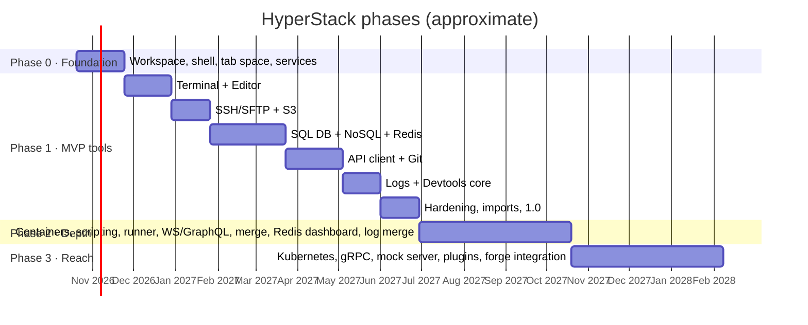

# 07 — Roadmap

**Status:** draft · **Last updated:** 2026-10-10

Effort assumes one experienced Rust developer working mostly full-time, able to
read Eden Explorer for reference but writing every module fresh. Weeks are
rough. Phases are sequential;
milestones inside a phase can overlap.

## Phase 0 — Foundation (≈ 5 weeks)

Goal: an empty but complete shell. Every later tool plugs into this without
changing it.

- [x] `.forgejo/workflows/ci.yml` and `release.yml` active (fmt gate, clippy `-D warnings`, tests, `cargo deny`, release build, `--self-test` smoke; both no-op until `Cargo.toml` exists); release scripts in `scripts/` (`next-release`, `update-version`, `build-and-package`, `verify-release`)
- [x] Cargo workspace with `[workspace.package] version`, every crate `version.workspace = true`; `deny.toml` — Linux/macOS CI follow when runners exist
- [x] App icon: `assets/icon/hyperstack.png` master, `hyperstack.ico` and PNG sizes generated by `scripts/make-icons.ps1`
- [x] Binary: `--version`, `--self-test`, `--data-dir`, `--finish-update`; `build.rs` embeds `hyperstack.ico`, git sha, build date, channel and Windows version resources; window icon set with `with_icon`
- [x] Minisign key pair generated (`keys/README.md`), `keys/minisign.pub` committed and embedded, `HS_MINISIGN_KEY` forge secret set; first `feat:` push published `v0.1.0` with the full asset contract and passed `verify-release.ps1` (2026-10-10)
- [x] Pester tests for `next-release.ps1` under `scripts/tests/`
- [x] `hs-core`: `Tool`/`ToolFactory` traits, `Services`, `ToolContext`, actions queue
- [x] `hs-core`: tokio runtime, `UiWaker`, `Jobs` with progress/cancel, `Events` bus
- [x] `hs-core`: **portable paths** (`HyperStackData/` beside the exe, writability probe, fallback, `--data-dir` flag), atomic TOML/JSON io, schema versioning (SQLite history db moves to M3, its first consumer)
- [x] `hs-core`: `Connections`, `Environments`, variable substitution engine (with tests), `Secrets` (encrypted vault with master password; DPAPI remember-me and the OS keyring option move to M1)
- [x] `hs-core`: settings, shortcuts/keymap, i18n (Fluent), `tracing` with redaction
- [x] `hs-ui`: theme system, multi-row `TabStrip` (generic over `TabItem`), `SplitLayout`, `Palette` with providers, `Tree`, `DataTable` (first version), toasts, dialogs, `EnvBanner`, `KeyValueEditor`
- [x] `hyperstack` bin: window, top bar, activity rail, sidebar, dock, status bar, launcher, settings window, workspace open/create/switch, layout persistence
- [x] Two dummy tools (Scratchpad, Welcome) to prove the plumbing; `egui_kittest` interaction test for the tab strip (no image snapshots: the runner has no GPU)
- [x] `portable-pty` verified on Windows ConPTY (needs the `ESC[6n` DSR reply, see CLAUDE.md); PowerShell 7 profile loading is verified in M1 with the real terminal

Exit: unzip `HyperStack.exe` into an empty folder on a USB stick, run it,
create a workspace, define an environment with a secret variable, open 30
tabs that wrap onto rows, split, save layout, close, move the whole folder to
another PC, run again: everything restored after the master password, no
plaintext secret on disk, nothing written outside the folder (verified with
Process Monitor in CI-adjacent manual test and by a registry/`%APPDATA%` diff
in the e2e test).

## Phase 1 — MVP tools (≈ 29 weeks) → v1.0

### M1 · Terminal + Editor (5 w)
- [x] `hs-term`: grid on `alacritty_terminal`, listener, key encoding; `portable-pty` local; shell profile detection (PowerShell 7/5, cmd + Clink, Git Bash, WSL)
- [x] `tool-terminal`: tabs, splits, "open here" action, profiles settings, right-click copy/paste, scrollback search (Ctrl+Shift+F), Ctrl+click links (URLs, `path:line:col`)
- [ ] Terminal settings: a Terminal List of CLI profiles (mysql, psql, mongosh, redis-cli, claude, opencode, custom) on the Terminal page between Security and Connections, reorderable, with PATH suggestions; the Terminal activity sidebar shows them under Shells (docs/tools/terminal.md §5, 2026-10-19)
- [x] `hs-editor`: ropey buffer, cursor/selection model, grouped undo/redo, syntect highlighting (incremental, per visible lines), gutter, find/replace, bracket match, indent, multi-cursor
- [x] `tool-editor`: project tree with `notify` watcher, open/save (local files; VFS schemes with M2), encodings, line endings, dirty and external-change handling, quick-open provider
- [x] Markdown preview (pulldown-cmark) in the editor with a native Mermaid subset (flowchart, sequence)
- [x] Settings → Updates: version display, **Check now**, release notes, download Job with verification (size, sha256, manifest signature, `--self-test`), restart-and-install by rename, `--finish-update` handshake, keep previous + **Revert**

### M2 · SSH/SFTP + S3 (4 w)
- [ ] `tool-ssh`: host profiles, import `~/.ssh/config`, auth methods, agent, jump hosts, known hosts in `HyperStackData/`, shell tab over `hs-term`
- [ ] `tool-ssh`: SFTP dual pane on `DataTable`, transfer queue in `Transfers`, resume, chmod, open-in-editor and save back via `sftp://` VFS
- [x] `Tunnels` service (local forward) ready for DB/Redis/API
- [x] `tool-s3`: profiles + import AWS files, SigV4 client in `hs-core::objstore`, bucket/prefix browsing, uploads with multipart, downloads, delete with guard, presigned URLs — the `s3://` VFS moves to M6 with the `sftp://` one (editing goes through a temp file meanwhile)

### M3 · SQL database + NoSQL + Redis (8 w)
- [x] `tool-db`: `DbSession` trait (was `DbDriver`); drivers SQLite (`rusqlite`), PostgreSQL (`tokio-postgres`), MySQL/MariaDB (`mysql_async`)
- [x] Schema browser, SQL editor with completion from schema cache, run statement/selection/script, cancel
- [x] Result grid streaming into its own grid, cell viewer, copy/export CSV/JSON/Markdown/INSERT
- [x] History, saved queries (`.sql` + header), transactions toggle, read-only, destructive classifier + guard, SSH tunnel
- [x] `tool-nosql`: `DocStore` trait; MongoDB driver (databases/collections tree, find with filter/projection/sort, aggregation, document tree/table/JSON views, Extended JSON editing, insert/update/delete with guards); CouchDB driver (databases, documents with `_rev`, Mango queries) — 2026-10-16; attachments, views, schema inference and the P1 stores pending (`docs/tools/nosql.md` §12)
- [x] `tool-redis`: connection (standalone/TLS/ACL, tunnel), SCAN key tree, type viewers/editors for all core types, TTL ops, console with guards — 2026-10-16 (command completion and the live dashboard pending, `docs/tools/redis.md` §11)

### M4 · API client + Git (6 w)
- [x] `tool-api`: request editor (params/headers/body/auth: basic, bearer, API key; OAuth2 and SigV4 pending), send with timing, response viewer (pretty/raw/preview, headers, cookies), history, curl import/export — 2026-10-15
- [x] Collections (one JSON file each), variables with scopes, Postman v2.1 import/export; JavaScript `pm` scripts on Boa — 2026-10-15 (Insomnia, Bruno and OpenAPI importers 2026-10-18)
- [ ] `tool-git`: repo detection in project tree, status via `gix`, stage/unstage file + hunk, diff viewer on `hs-editor`, commit, branches, stash list, fetch/pull/push via git CLI with progress, credential helper passthrough, protected-remote guard

### M5 · Logs + Devtools core (4 w)
- [ ] `tool-logs`: local file engine (index, backward paging, follow with rotation detection), SSH source (`tail -F` over exec channel, SFTP range fallback), parsers (plain/JSON/logfmt/syslog/combined/multi-line stack traces), filters, highlight rules, level colours, structured columns, find, bookmarks, saved sources
- [x] `tool-devtools`: JSON/YAML/TOML/XML format+convert, regex tester, cron builder, UUID/ULID, timestamp converter, text diff — JWT, Base64, hashes/HMAC, Jasypt, PKI messages and Firebase tokens 2026-10-15; cron, generators, conversions 2026-10-17; regex tester and text diff (on `similar`, not `hs-editor`) 2026-10-18

### M6 · Hardening and 1.0 (4 w)
- [ ] Protected environments across all tools; e2e secret-grep test; `cargo deny` clean
- [ ] Importers polish, export workspace, team `.gitignore` template, `.local.toml` overrides
- [ ] Performance pass against budgets (startup, 1 M-row grid, 100 MB file, 2 GB log)
- [ ] Updates: automatic daily check with badge, "download and install on exit", install from file (offline), CHANGELOG rendering in-app, crash-before-first-frame auto-revert offer, read-only-folder fallback to zip download
- [ ] Docs: user guide, shortcuts page, release notes; signed portable zip for Windows (no installer, Authenticode if a certificate is obtained), tarball/AppImage for Linux, notarised app bundle for macOS
- [ ] Translations: `en` complete, structure for others

## Container activity (owner's request, 2026-10-24)

Pulled forward from Phase 2 and ahead of M6 at the owner's request:
Docker (single container, Compose, Swarm), Podman, Kubernetes and
Windows containers as one activity. Specified in
`docs/tools/containers.md` §10 (which keeps the existing §1-§9
resource requirements), decided in ADR-026. Eight phases, each green
on the full gate and releasable:

- [x] 1 · `hs_ui::table::DataTable` scrolls instead of clipping (fixes S3 and SFTP too); `podman`/`wincontainer` connection kinds; Settings → Containers with the Container List and the per-kind forms; vault wiring
- [x] 2 · `hs-container` Docker/Podman driver: the CLI across all four transports, verified against a real engine behind an env var. `bollard` deferred to phase 4 for streaming (see `docs/tools/containers.md` §10.3a)
- [x] 3 · The activity, its rail entry, the dashboard, the two-section sidebar, one tab per host
- [ ] 4 · Docker pane (Portainer-shaped): containers, images, volumes, networks; start/stop/restart; Logs and Exec handed to `tool-logs` and `hs-term`
- [ ] 5 · Compose and Swarm
- [ ] 6 · Kubernetes driver (`kube` + `k8s-openapi`, with Use kubectl as the escape hatch) and the Lens-shaped pane: namespaces, workloads, events, YAML
- [ ] 7 · Apply with a dry-run diff, port-forward, CRD discovery
- [ ] 8 · AI assistant, prompt buttons, `hs-container` action blocks, the Problems feed

The Phase 2 "Containers" line below is superseded by this; the Phase 2
Logs line keeps its own Docker/Kubernetes **log source** work, which
feeds the same handoff.

## Phase 2 — Depth (≈ 16 weeks)

- [ ] Containers: Docker/Podman (local, TCP, over SSH), compose; logs feed `tool-logs`, exec feeds `hs-term`
- [ ] API: Rhai pre/post scripts and assertions, collection runner with report, WebSocket + SSE, GraphQL introspection, cookie jar, client certs, proxy
- [ ] SQL: SQL Server, inline editing with preview, explain plan tree, CSV import, Excel export
- [ ] NoSQL: Elasticsearch/OpenSearch and DynamoDB drivers, index management, explain, schema inference, import/export, copy collection across environments, CouchDB views and replication
- [ ] Redis: server info dashboard, slowlog, client list, pub/sub tab, streams with consumer groups, big-key finder, bulk delete with dry run, export/import
- [ ] Logs: Docker/Kubernetes/journalctl/Windows Event Log sources, multi-source merge, statistics sparkline, alerts, save filtered output
- [ ] Editor: tree-sitter highlighting and folding, minimap, snippets, external formatter, three-way merge editor
- [ ] Git: log graph, blame, file history, merge/rebase/cherry-pick/revert/tags, conflict resolution
- [ ] SSH: port-forward manager UI, broadcast input, server monitor widget, saved commands
- [ ] S3: object metadata/tags/versions, sync with dry run, policy/CORS viewer
- [ ] Shell: cross-tool drag and drop, global search, optional installed mode (per-user data folder) for people who prefer it
- [ ] Delivery: Linux x64 release built on the Windows runner with `cargo-zigbuild`, beta channel from a `beta` branch, mirror `source` setting for managed networks
- [ ] Devtools: network tools, process/port viewer, snippet manager, `.env` editor, scratchpad, SQL formatter, fake data

## Phase 3 — Reach (≈ 16 weeks)

- [ ] Kubernetes: contexts, namespaces, workloads, pods logs/exec/port-forward, describe, apply
- [ ] API: gRPC (reflection + proto import), mock server from collection/OpenAPI, OpenAPI export
- [ ] SQL: ER diagram, DDL generator, schema compare, data compare, ClickHouse/DuckDB
- [ ] NoSQL: Cassandra/ScyllaDB (CQL), Firestore/Cosmos/Neo4j evaluation
- [ ] Git forge integration: GitHub/GitLab/Forgejo PRs, issues, CI status
- [ ] Plugin API (WASM via `wasmtime`): devtools utilities and importers first
- [ ] Detachable tabs (multiple viewports), session audit log, presentation mode
- [x] Optional AI assistant (bring your own service) in the editor (ADR-019); review-only assistant with Insert in Terminal, SSH, SQL, S3, API client and Graphics (2026-10-15)
- [x] Graphics tool (`tool-graphics`) and embedded Browser (`tool-browser`, WebView2 on Windows) — owner's requests, 2026-10-15
- [x] Home tab, theme modes, Read Aloud, Snip/Print, settings bundles — 2026-10-15 (ADR-022)

## Graphics diagram suite (owner's request, 2026-10-19)

The Graphics activity becomes four tools — Image, Icon, Diagram Editor and
Diagram Generator — split into two releases. The requirements and design are in
[tools/diagrams.md](tools/diagrams.md); the Archify adaptation is recorded in
`THIRD_PARTY_NOTICES.md` and ADR-025.

### Release 1 — activity, Image/Icon and flow/architecture diagrams

- [x] Graphics activity shell: dashboard home tab, sidebar function list,
      Recent section, right-click menus, commands (2026-10-19)
- [x] Separate Image and Icon tabs; in-pane settings and preview; image → icon
      (2026-10-19)
- [x] Icon colour-key transparency with eyedropper and tolerance (2026-10-19)
- [x] `hs-diagram`: model, validation, scene, layout, SVG and PNG/PDF export
      (2026-10-19)
- [ ] Diagram Editor: flowchart and architecture, direct manipulation, undo,
      save/open `.hdiag`, drafts, project save, templates, Mermaid flowchart
      import (canvas, selection, drag, add/connect, undo, templates,
      save/export and close-time drafts implemented; project save,
      debounced autosave, resize/align and Mermaid remain)
- [ ] Diagram Generator: prompt, examples, AI providers, offline templates,
      validation/repair, preview, open in editor, export (prompt, examples, AI,
      offline templates, the one repair round, preview, open in editor and export
      implemented 2026-10-20)
- [x] AI assistant in all four tools with quick actions and More Suggestions
      (review-only; implemented 2026-10-20)
- [x] Archify schema adaptation with `THIRD_PARTY_NOTICES.md`, pinned v3.2.0,
      and the strict IR validator (2026-10-19)
      (schemas and notice committed; validator, About page and notice test
      pending)
- [ ] Tests, documentation, screenshots and GIF

### R1.1 — finishing the editor (implemented 2026-10-20)
- [x] Save Diagram modal into a project's `docs/diagrams/` folder
- [x] Debounced draft autosave
- [x] Resize handles and multi-select align/distribute
- [x] Edge label and waypoint editing

### Release 2 — more diagram types and imports

- [ ] ERD: entities, columns, types, keys and cardinality
- [x] Sequence: basic participants/messages template and Mermaid sequence import (2026-10-20)
- [x] Archify JSON import from the adapted schemas (2026-10-20)
- [x] draw.io XML import: plain and compressed, first page, basic styles
      (2026-10-20)
- [x] `.diagram.json` alias (2026-10-20); schema migration still open
- [x] Mermaid sequence import (2026-10-20)

## Release cadence

Releases are automatic: every push to `main` with a `feat`/`fix`/`perf`/
`security` commit publishes a version (see [09](09-ci-cd-and-updates.md)).
In practice:

- `0.x` versions flow continuously through Phase 0 and Phase 1; `0.1.0` marks
  the Phase 0 exit, and each milestone's last merge lands as a minor bump.
- `1.0.0` is forced with a `release: 1.0.0` trailer at the end of Phase 1.
- Phase 2/3 continue with automatic minors and patches; `beta` branch
  pre-releases precede risky changes.

## Risks and mitigations

| Risk | Impact | Mitigation |
|---|---|---|
| Building a credible text editor in egui is a lot of work | M1 slips, editor feels weak | Scope to "lightweight": rope + highlighting + find first; evaluate `egui_code_editor` and Lapce's `floem` editor core as references; tree-sitter and LSP deferred |
| Writing everything fresh instead of porting from Eden Explorer costs time | Phase 0/1 take longer than a port would | Accepted on purpose (ADR-014): cleaner architecture and cross-platform from the start; reading Eden for behaviour still saves most of the design time |
| Portable folder on a slow USB stick or a synced folder (OneDrive) | SQLite locking, slow startup, sync conflicts | WAL mode with `synchronous=NORMAL`, small writes, debounced saves; detect cloud-sync folders and warn once; `--data-dir` to relocate |
| `gix` lacks stable push/merge | Git tool blocked | Hybrid design from day one: `gix` for reads, `git` CLI for writes/network (ADR-006) |
| egui text rendering of huge grids/logs | Frame drops | Virtualise everything; render only visible rows; cache galleys per row; measured budgets in CI |
| Vault usability (master password fatigue) and opt-in keyring differences across OSes | Users store secrets outside the app | DPAPI "remember on this PC" on Windows, idle relock instead of per-use prompts; keyring backends behind one trait with integration tests per OS |
| Driver crate maturity (`tiberius`, `redis` cluster, CouchDB has no maintained crate so we use its HTTP API directly, `aws-sdk-dynamodb` is heavy) | Partial features | Feature-gate, ship when solid, document gaps; thin HTTP clients where SDKs are too heavy |
| Scope creep from the catalogue | 1.0 never ships | P0 list is frozen at the start of Phase 1; new ideas go to P1/P2 |
